# Poolwerk – meine Poolsteuerung

Ich möchte euch hier meine Poolsteuerung vorstellen. Poolwerk läuft bei mir zu Hause und ist entstanden, weil mir bei meiner bisherigen ProCon.IP die Analogregeln und Eingänge nicht mehr gereicht haben. Ich brauchte vor allem mehr Anschlüsse für die Belimos und deren Endschalter.

Meine komplette Pooltechnik steht im Keller. Dass mir bei einem Defekt das Poolwasser in den Keller läuft, ist dabei meine größte Sorge. Deshalb gehören Wassersensoren, das Schließen der Ventile und eine zusätzliche Pumpe von Anfang an dazu.

Die Ventilstellungen wollte ich über Endschalter zurückbekommen. Nur weil der Antrieb angesteuert wird, weiß ich ja noch nicht, ob das Ventil auch wirklich offen oder geschlossen ist.

Die Steuerung läuft schon am Pool, fertig bin ich mit dem Projekt aber noch nicht. Weiter unten gibt es Fotos vom Aufbau und die technischen Angaben.

## Steuerung und Home Assistant

Poolwerk läuft eigenständig auf einem ESP32-S3. Die Software nutzt ESPHome mit ESP-IDF, die Poolregelung und die Abläufe laufen direkt auf dem Chip. Wenn Home Assistant ausfällt oder ausgeschaltet wird, arbeitet die Steuerung weiter.

Ich kann alles über das Webportal im eigenen Netzwerk oder an den beiden Displays mit Drehknopf bedienen. Internet wird dafür nicht gebraucht. Home Assistant nutze ich zusätzlich für die Anzeige und Bedienung im Haus. Nur Funktionen, die von außen kommen, etwa eine externe PV-Freigabe, brauchen auch diese Verbindung.

Die Verarbeitung findet vor Ort statt. Konkrete Reaktionszeiten habe ich bisher nicht gemessen.

## Funktionen

Man kann erst einmal mit der Filterpumpe anfangen und später erweitern. Je nach angeschlossener Technik kann Poolwerk Folgendes übernehmen:

- Filterpumpe mit Wochenprogramm und optionalen Drehzahlstufen
- Ventile mit Belimo-Antrieben und Endlagenrückmeldung
- Messung von pH, Redox, freiem Chlor, Salz und Temperaturen
- Wasserpflege mit Flüssigchlor oder Salzelektrolyse sowie pH-Minus und pH-Plus
- Überwachung von Durchfluss, Filterdruck und Elektrolysestrom
- Wärmepumpe, PV-Freigabe und Gegenstromanlage
- Wasserstand, automatische Frischwassernachfüllung und Wasseralarm
- Messverläufe, Diagnose, Kalibrierung und Sicherung der Einstellungen

Was nicht vorhanden ist, lässt sich in den Einstellungen abschalten. Poolwerk läuft also auch ohne Belimos, mit von Hand eingestellten Ventilen. Flüssigchlor, Elektrolyse, pH-Minus und pH-Plus werden passend zur Anlage eingerichtet.

## Filterpumpe, Ventile und Wasseralarm

Die Filterpumpe hat ein Wochenprogramm mit bis zu 16 Zeitfenstern pro Tag. Weitere Pumpenstufen sind optional. Ob tatsächlich Wasser fließt, wird über den Hauptdurchfluss geprüft; Filterdruck und Messzellendurchfluss ergänzen die Überwachung.

Bei meinen Ventilen melden Endschalter die offene und geschlossene Stellung zurück. Ohne Endschalter kann Poolwerk mit einer eingestellten Fahrzeit arbeiten. Dann wird die Stellung allerdings nur angenommen. Die Rückspülfunktion unterstützt den Ablauf; den Filterkopf stelle ich in meinem Aufbau weiterhin von Hand um.

Die Frischwassernachfüllung läuft bei mir inzwischen ebenfalls. Eingestellt wird sie im Webportal unter „Wasserstand und Frischwasser“.

Bei Wasser im Keller schaltet der Sensor die zusätzliche Pumpe ein und später wieder aus. Poolwerk lässt gleichzeitig die dafür eingerichteten Ventile zufahren und prüft die Endschalter. Das ist mir bei der Anlage im Keller besonders wichtig.

Weitere Fotos von Wasserwegen, Pumpe und Endschaltern

| Wasserweg im Technikraum | Ventilantrieb mit Endschaltern |
| --- | --- |
|  | 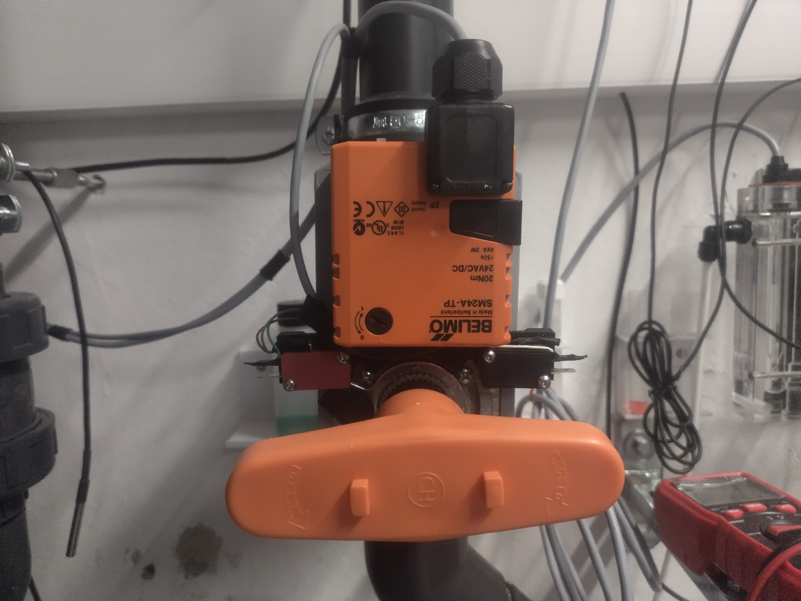 |

| Verrohrung und Elektrolyse | Pumpe mit motorisierten Ventilen |
| --- | --- |
|  | 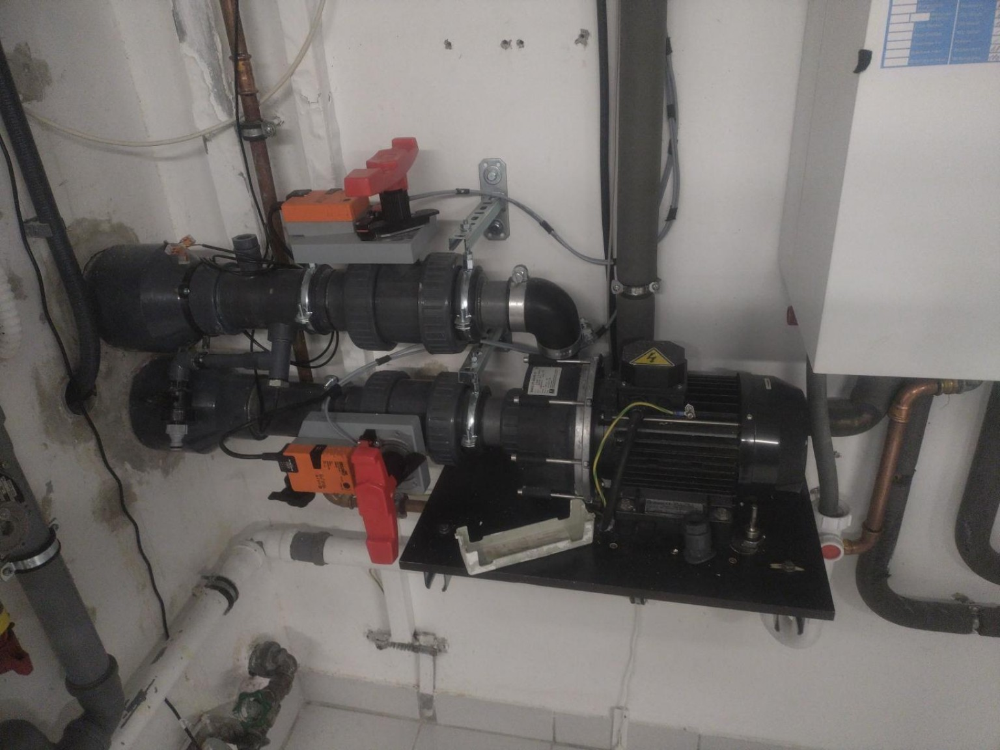 |

| Belimo mit rotem Ventilgriff | Endschalter im Detail |
| --- | --- |
| 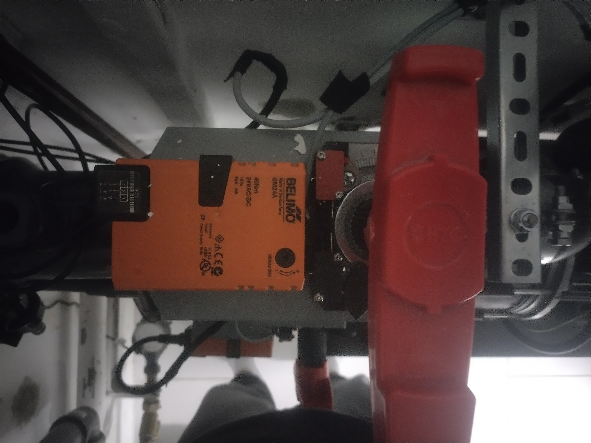 |  |

Die zusätzliche Pumpe im Keller

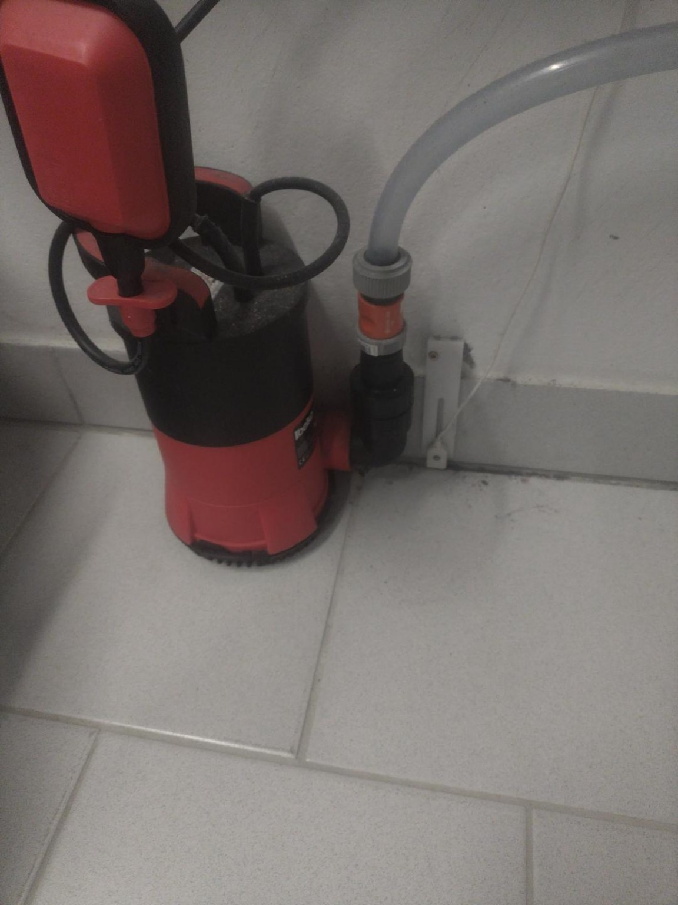

## Wasserpflege

Für die automatische Chlorzugabe wird der Redoxbedarf ausgewertet. Die separate Chlormessung begrenzt zusätzlich die Zugabe. Je nach Ausstattung steuert Poolwerk dafür eine Flüssigchlorpumpe oder eine Elektrolyse an. Bei mir arbeitet eine Zodiac LM2-40 mit Stromüberwachung und automatischer Umpolung.

Für pH-Minus stelle ich Sollwert, Förderleistung, Dosierpausen und Mengengrenzen ein. pH-Plus kann man bei Bedarf dazunehmen.

Auch bei Handfunktionen bleiben die jeweiligen Freigaben wichtig: pH-Minus stoppt am Sollwert, bei Flüssigchlor bleibt die Chlorgrenze wirksam. Für die Elektrolyse gibt es einen bewusst bestätigten, zeitlich begrenzten Handlauf, der die automatische Redox-/Chlorentscheidung übersteuern kann.

## Hardware

Als Zentrale verwende ich einen ESP32-S3. Die Firmware unterstützt zwei Boardprofile:

| Board | Flash | PSRAM |
| --- | ---: | ---: |
| ESP32-S3 N32R16V | 32 MB | 16 MB |
| ESP32-S3 N16R8 | 16 MB | 8 MB |

Diese Module und Sensoren gehören zu meinem Aufbau:

| Bauteil | Wofür ich es verwende |
| --- | --- |
| Atlas Scientific EZO-pH und EZO-ORP | pH- und Redoxmessung |
| Atlas EZO-EC mit Apera 2301-C, K = 1,0 | Leitfähigkeit und daraus berechnete Salzanzeige |
| ProCon.Cl-Sonde mit Potentiostat | Messung des freien Chlors |
| Zwei ADS1115 | Auswertung der analogen Signale |
| MCP23017 | Zusätzliche Ein- und Ausgänge |
| TUF-2000M über RS485/Modbus | Hauptdurchfluss |
| Y201-Impulsgeber | Durchflussmessung |
| DS18B20 | Temperaturen an verschiedenen Stellen |
| Analoger Drucksensor | Filterdruck |
| ACS712 | Strommessung der Elektrolyse |
| W5500 | LAN-Verbindung; WLAN steht ebenfalls zur Verfügung |
| DS3231 und microSD | Echtzeituhr und lokale Aufzeichnung |
| Zwei TFT-Displays und EC11-Drehencoder | Bedienung am Gerät |

Die Temperatur für die Salzberechnung kommt vom Fühler an der Messzelle. Kalibriert werden die Messmodule über die Bedienoberfläche.

Im gezeigten bisherigen Aufbau sind vier MCP23017 mit 64 digitalen Ein- und Ausgängen und 24 Relaiskanäle vorgesehen. Das Gehäuse bietet Platz für fünf MCP23017 und vier 8-Kanal-Relaisplatinen: also 80 I/Os und 32 Relais. Die Relais belegen dabei einen Teil dieser I/Os.

Weitere Module können in ein zusätzliches Gehäuse wandern. Grenzen setzen die verfügbaren Adressen, der Bus, die Versorgung und die Firmware. Pro I²C-Bussegment sind bis zu acht MCP23017 möglich; darüber hinaus müsste der Busaufbau erweitert werden.

### Versorgung der Messmodule

Die Atlas-Carrier werden über einen rauscharmen LT3045 versorgt. Die Messkreise für pH, Redox, Leitfähigkeit und Chlor sind galvanisch getrennt aufgebaut.

Bei der Chlormessung hatte ich anfangs das Problem, dass die Anzeige bei stillstehender Anlage abfiel. Dafür habe ich jetzt einen isolierten TRACO-Wandler, einen separaten ADS1115 und die ISO1640-I²C-Trennung auf einem Pololu-5392-Modul verbaut. Mit dem getrennten Aufbau ist das bei mir nicht mehr aufgetreten.

### Antriebe mit 24 V

Belimos, Dosierpumpen und der Umschalter der Elektrolyse arbeiten bei mir mit 24 V. Die Elektronik bekommt je nach Modul die passenden niedrigeren Spannungen.

230-V-Verbraucher werden über separate Schütze im Verteiler geschaltet. Poolwerk steuert deren 24-V-Spulen an; die Leistungskontakte übernehmen die Netzspannung.

Bei der externen Drehzahlsteuerung der Filterpumpe kommt außerdem ein PhotoMOS zum Einsatz. Er verbindet den gemeinsamen Signal-GND erst, wenn Poolwerk ihn aktiv einschaltet. Fällt die Versorgung der Steuerung aus, öffnet dieser Signalweg wieder. Das ist eine Freigabe für die Steuersignale, keine Abschaltung der Netzversorgung. Wie die Pumpe ohne diese Signale reagiert, hängt von ihrer Einstellung ab.

PhotoMOS-Auswahl und Ventilrückmeldungen im Webportal ansehen

### Dosierpumpe

Die Dosierpumpe habe ich aus einem SEKO PP Dosiergerät für die Spülmaschine Meiko FV28GIO umgebaut. Sie läuft mit 24 V und hat ein gedrucktes Gehäuse, ein SEKO-Drehkreuz und einen Santoprene-Schlauch in 6,25 × 10,65 mm.

Die Pumpe ist ausgelitert, die Fördermenge also am fertigen Aufbau gemessen. Am Motor sitzt eine Freilaufdiode gegen die Spannungsspitze beim Abschalten. Das Foto der fertigen Pumpe reiche ich noch nach.

## Bedienung und Messverläufe

Direkt am Gehäuse bediene ich die Menüs mit dem Drehknopf und lese die Werte auf den beiden Displays ab. Im Webportal finde ich die Einstellungen für Pumpe, Wasserpflege und die anderen Bereiche. Kalibrieren und Einstellungen sichern geht dort ebenfalls.

Bedienmenü und Störungsanzeige ansehen

| Bedienung mit Drehknopf | Beispiel einer Störungsmeldung |
| --- | --- |
| 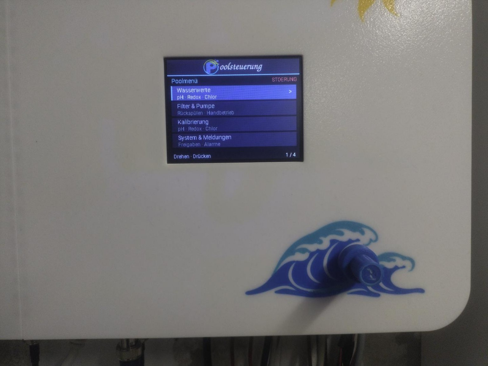 |  |

Filterpumpe, Wärmepumpe sowie pH und Redox ansehen

**Filterpumpe:** Zuordnung der Pumpenstufen und Ventile; weitere Reiter führen zu Betrieb, Wochenprogramm, Messwerten und Diagnose.

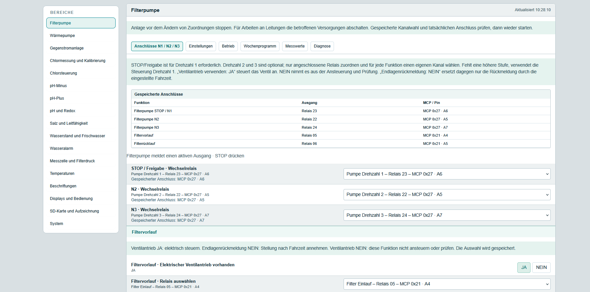

**Wärmepumpe:** Betriebsart, Schaltausgang, MQTT-Anbindung und zugehörige Ventile lassen sich passend zur Ausstattung einstellen.

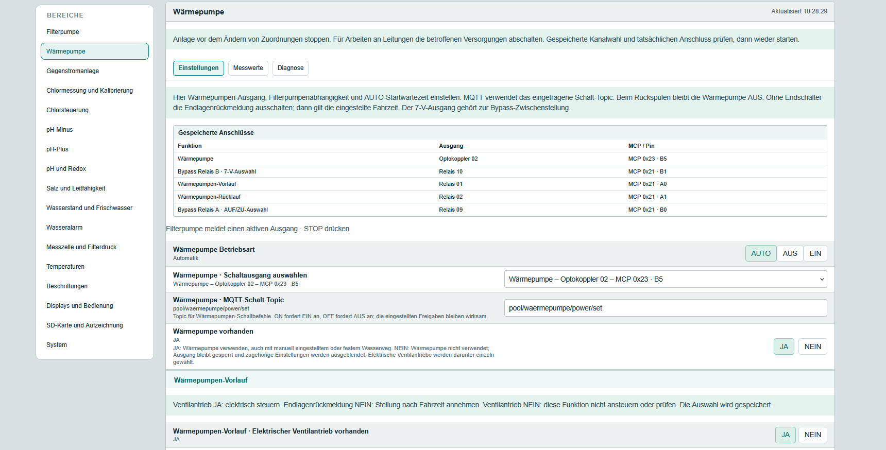

**pH und Redox:** Sollwerte, Anzeigebereiche und Regelgrenzen sind getrennt einstellbar. Kalibrierung und Messwerte haben eigene Reiter.

Systemdiagnose ansehen

Die Systemansicht zeigt CPU-Auslastung, Temperatur, freien Speicher und Laufzeit. Zähler zu LAN-Unterbrechungen und Wiederherstellungen unterstützen die Fehlersuche.

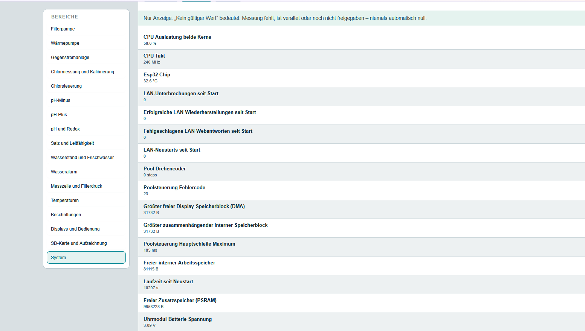

Im Mitschreiber schaue ich mir die Messwerte über die Zeit an, zum Beispiel wenn sich beim Einschalten einer Pumpe etwas verändert. Hier ist ein pH-Verlauf ohne Glättung:

So sieht die zusätzliche Anzeige bei mir in Home Assistant aus:

Mein Home-Assistant-Dashboard

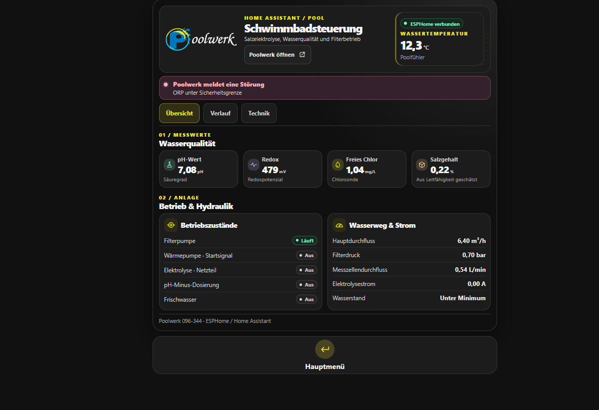

## Chemie-Rechner

Im Webportal steckt auch ein manueller Rechner für aktives Chlor, Chlorzugabe, pH-Minus, pH-Plus und Alkalinität. Dafür trägt man seine Messwerte, das Beckenvolumen und die Angaben des jeweiligen Produkts ein.

Beim aktiven Chlor wird aus DPD1, Cyanursäure und pH ein Modellwert bei 25 °C berechnet. Das ist keine zusätzliche Sensormessung. Der Rechner verändert keine Sollwerte und startet keine Dosierung.

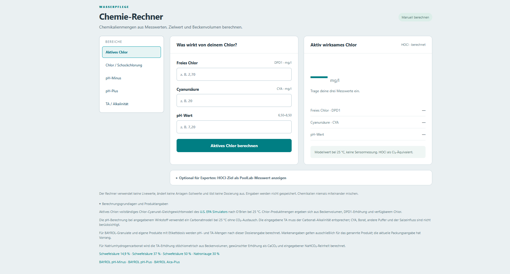

Ansicht der Chlor-Mengenberechnung öffnen

## Konstruktionen aus Fusion

Hier sind die Fusion-Zeichnungen der Belimo-Halterungen und Adapter für meine Ventile. Auch die Teile für die Endschalter, der längere Mikroschalter-Pin, die Sondenstopfen und das Gehäuse gehören dazu.

Weitere Fusion-Ansichten: Platte, Adapter und Mikroschalter-Pin

| Platte mit Befestigungsbohrungen | Geripptes Adapterteil |
| --- | --- |
|  | 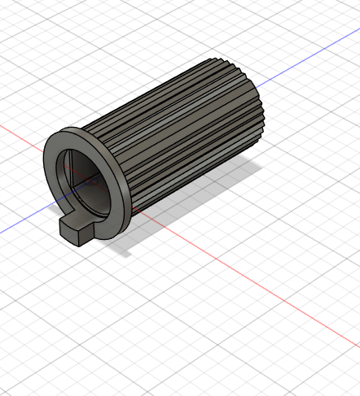 |

| Weiteres Verbindungsteil | Längerer Betätigungspin für den Mikroschalter |
| --- | --- |
| 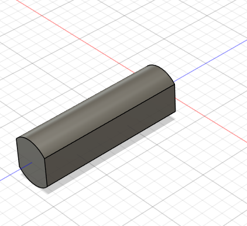 |  |

Sondenstopfen, Gehäuse und Front in Fusion

Die Grundzeichnung zeigt die Anordnung der Elektronik. Zusätzliche Halterungen und Erweiterungen werden ins Gehäuse eingeklebt.

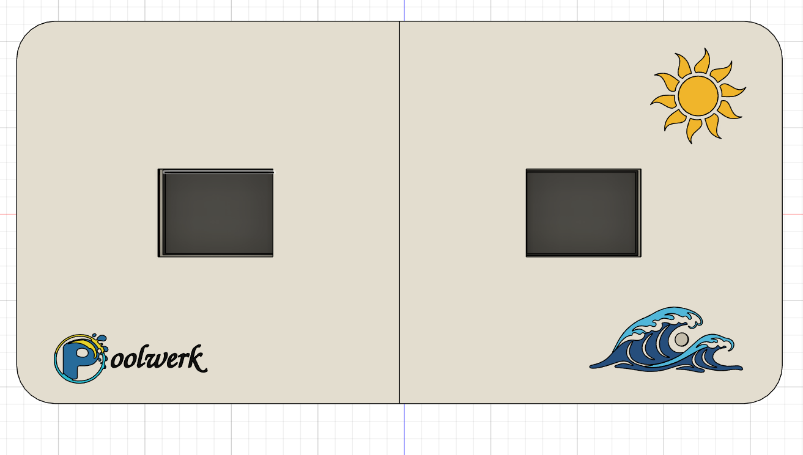

## Aufbau und Trägerplatine

Die Verkabelung ist noch etwas wild, das sieht man auf dem Foto. Ich habe beim Aufbau immer wieder etwas ergänzt und umgebaut.

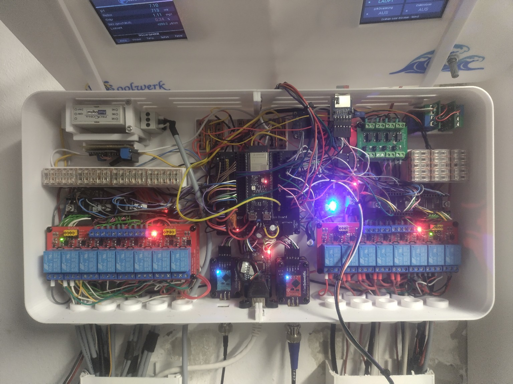

Einbau der Steuerung im Technikraum

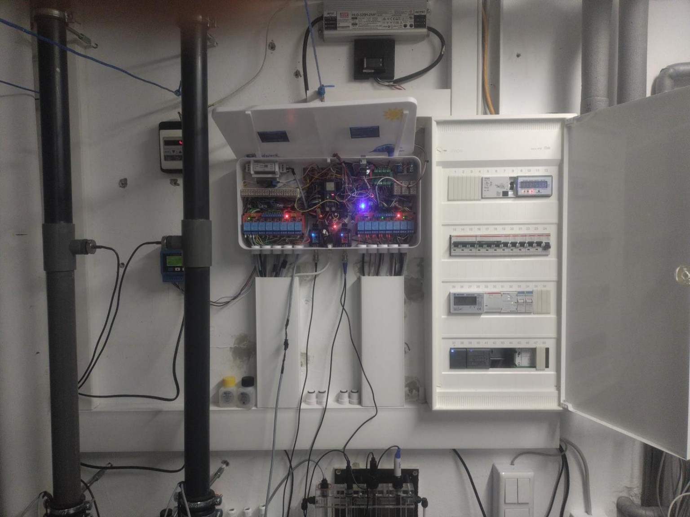

Für V2.0 bereite ich eine Trägerplatine vor, die ins Gehäuse passt. Die Module werden darauf gesteckt, damit ich weniger einzeln verkabeln muss.

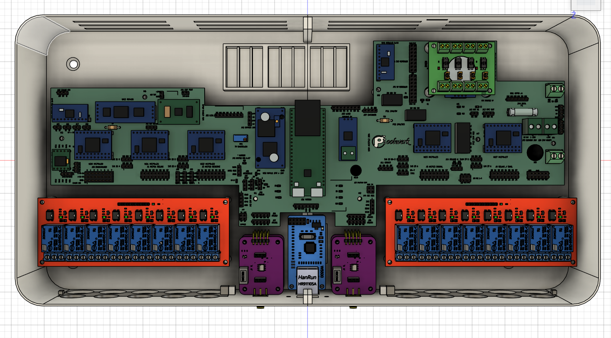

Das Bild oben zeigt die Planung in Fusion.

## Projektstand und Anleitung

Bisher läuft Poolwerk an meinem eigenen Pool. Später sollen im kleinen Kreis noch weitere Pools dazukommen.

Auf GitHub zeige ich erst einmal den Aufbau und die Funktionen. Die Firmware und die vollständigen CAD-Dateien sind hier nicht enthalten. Manche Fotos und Screenshots stammen noch aus älteren Entwicklungsständen.

[PDF-Leseprobe: die ersten zwei Seiten der Anleitung 096-351](dokumentation/Poolwerk_096-351_Anleitung_Leseprobe_Seiten_1-2.pdf)

Die Leseprobe enthält Titelseite und Inhaltsverzeichnis. Die zur installierten Firmware passende vollständige Anleitung lässt sich direkt an der Steuerung unter **Einstellungen → System → Anleitung herunterladen (PDF)** öffnen.
