# Poolwerk – meine Poolsteuerung

Poolwerk ist meine selbst gebaute Poolsteuerung. Angefangen hat das Ganze mit dem Wunsch nach mehr Eingängen und mehr Möglichkeiten für meine Anlage. Inzwischen gehören Elektronik, Software, Webportal und eine ganze Reihe selbst gezeichneter und gedruckter Teile dazu.

Die Steuerung läuft an meinem eigenen Pool und wächst mit den Erfahrungen im Alltag. Hier zeige ich, was daraus geworden ist – vom Technikraum bis zur nächsten Platine.

## Warum ich Poolwerk gebaut habe

Meine Pooltechnik steht im Keller. Der Gedanke, dass sich bei einem Defekt der Pool dort hinein entleeren könnte, hat mir keine Ruhe gelassen. Ich wollte austretendes Wasser erkennen, die Wasserwege schließen lassen und eine zusätzliche Pumpe einschalten.

Dazu kamen immer mehr Belimo-Antriebe und Endschalter. Bei meiner bisherigen ProCon.IP reichten mir dafür die Analogregeln und Eingänge nicht mehr. Das war der Anlass, eine eigene Steuerung aufzubauen.

Gerade die Endschalter waren mir wichtig: Wenn ich einem Ventil „ZU“ sage, möchte ich auch wissen, ob es wirklich zugefahren ist. Ein eingeschaltetes Relais allein sagt darüber noch nichts aus.

## Läuft auch ohne Home Assistant

**Poolwerk steuert den Pool selbst.** Messwerte, Regelungen, Zeitprogramme und Ventilabläufe werden direkt auf dem ESP32-S3 verarbeitet. Home Assistant kann ausgeschaltet sein oder neu starten – die lokale Steuerung läuft weiter.

Die Firmware basiert auf ESPHome mit ESP-IDF und der eigenen Poolwerk-Logik. ESPHome ist dabei die technische Grundlage; Home Assistant übernimmt nicht die Regelung.

Bedient wird Poolwerk über das eigene Webportal im lokalen Netzwerk oder direkt am Gehäuse mit zwei Displays und Drehknopf. Internet oder eine Cloud braucht es dafür nicht. Home Assistant nutze ich zusätzlich für mein Dashboard und die Einbindung ins Haus. Externe Vorgaben wie eine PV-Freigabe brauchen natürlich ihre jeweilige Verbindung.

Auch Schaltentscheidungen fallen direkt im Gerät, ohne auf einen Server zu warten. Eine feste Reaktionszeit für die gesamte Anlage habe ich bisher nicht gemessen. Sensorintervalle, Dosierpausen und Ventilfahrzeiten spielen dabei jeweils ihre eigene Rolle.

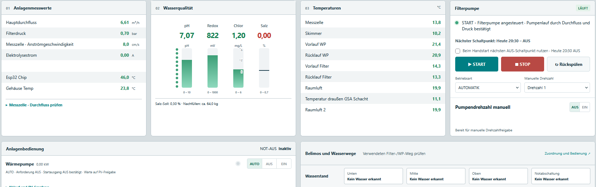

## Was alles dazugehört

Poolwerk lässt sich passend zur vorhandenen Technik einrichten. Man kann mit der Filterpumpe anfangen und später weitere Funktionen dazunehmen:

- Filterpumpe mit Wochenprogramm und optionalen Drehzahlstufen
- Ventile mit Belimo-Antrieben und Endlagenrückmeldung
- Messung von pH, Redox, freiem Chlor, Salz und Temperaturen
- Wasserpflege mit Flüssigchlor oder Salzelektrolyse sowie pH-Minus und pH-Plus
- Überwachung von Durchfluss, Filterdruck und Elektrolysestrom
- Wärmepumpe, PV-Freigabe und Gegenstromanlage
- Wasserstand, automatische Frischwassernachfüllung und Wasseralarm
- Messverläufe, Diagnose, Kalibrierung und Sicherung der Einstellungen

Die einzelnen Funktionen lassen sich ein- und ausschalten. Auch ohne Belimos funktioniert Poolwerk: Bei manuell eingestellten Wasserwegen bleiben die entsprechenden Ventilfunktionen einfach deaktiviert.

## Wasserwege und Kellerüberwachung

Die Filterpumpe hat ein Wochenprogramm mit bis zu 16 Zeitfenstern pro Tag. Weitere Pumpenstufen sind optional. Ob tatsächlich Wasser fließt, wird über den Hauptdurchfluss geprüft; Filterdruck und Messzellendurchfluss ergänzen die Überwachung.

Bei meinen Ventilen melden Endschalter die offene und geschlossene Stellung zurück. Ohne Endschalter kann Poolwerk mit einer eingestellten Fahrzeit arbeiten. Dann wird die Stellung allerdings nur angenommen. Die Rückspülfunktion unterstützt den Ablauf; den Filterkopf stelle ich in meinem Aufbau weiterhin von Hand um.

Die automatische Frischwassernachfüllung ist bereits in Betrieb. Wasserstand, Nachfüllung und die zugehörigen Einstellungen sind im Webportal zusammengefasst.

Erkennt der Wassersensor im Keller Wasser, wird die zusätzliche Pumpe eingeschaltet und später wieder ausgeschaltet. Gleichzeitig fordert Poolwerk die dafür eingerichteten Ventile zum Schließen auf. Die Endschalter melden zurück, ob die geschlossene Stellung erreicht wurde. Damit möchte ich einen möglichen Wasserschaden möglichst früh begrenzen.

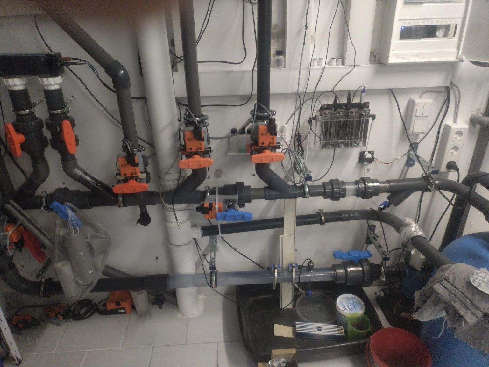

Weitere Fotos von Wasserwegen, Pumpe und Endschaltern

| Wasserweg im Technikraum | Ventilantrieb mit Endschaltern |
| --- | --- |
| 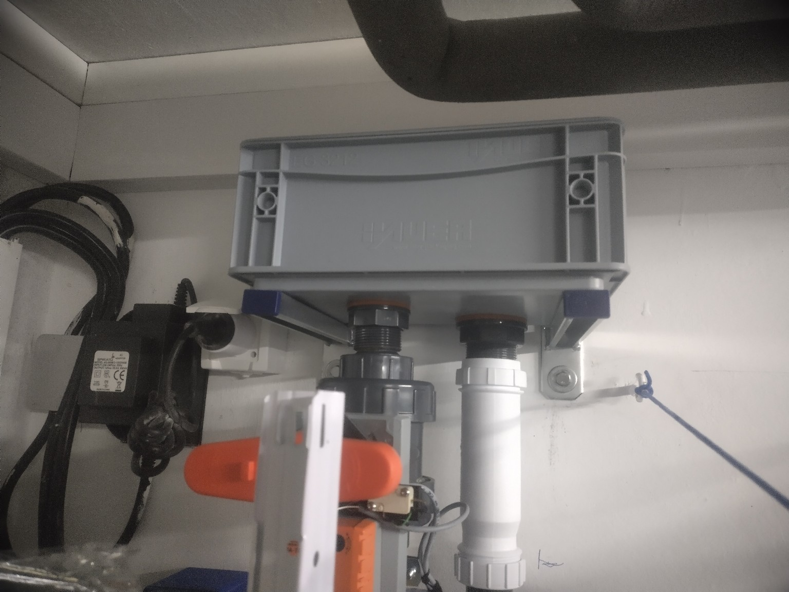 |  |

| Verrohrung und Elektrolyse | Pumpe mit motorisierten Ventilen |
| --- | --- |
| 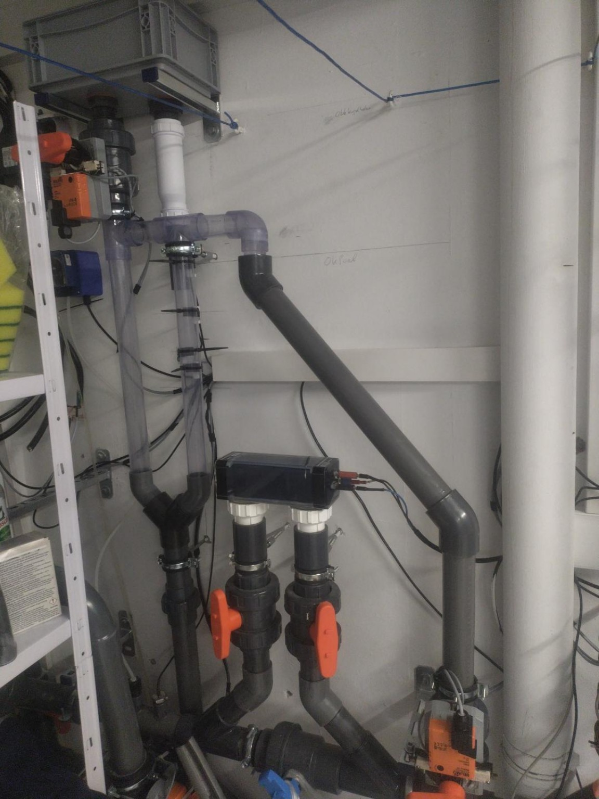 |  |

| Belimo mit rotem Ventilgriff | Endschalter im Detail |
| --- | --- |
|  | 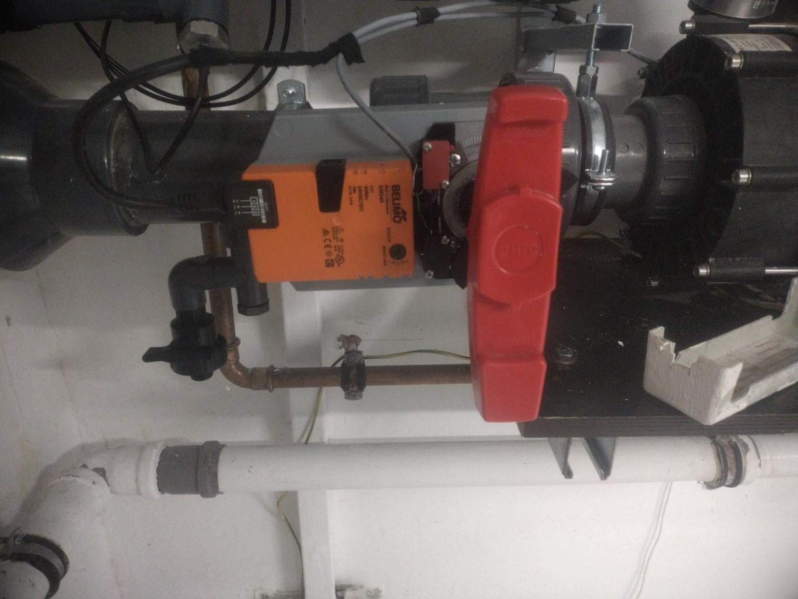 |

Die zusätzliche Pumpe im Keller

## Wasserpflege

Für die automatische Chlorzugabe wird der Redoxbedarf ausgewertet. Die separate Chlormessung begrenzt zusätzlich die Zugabe. Je nach Ausstattung steuert Poolwerk dafür eine Flüssigchlorpumpe oder eine Elektrolyse an. Bei mir arbeitet eine Zodiac LM2-40 mit Stromüberwachung und automatischer Umpolung.

Bei pH-Minus werden Sollwert, Förderleistung, Dosierpausen und Mengenbegrenzungen berücksichtigt. pH-Plus lässt sich als eigene Funktion aktivieren. Nicht jede Anlage muss dafür alle Pumpen und Messmodule haben.

Auch bei Handfunktionen bleiben die jeweiligen Freigaben wichtig: pH-Minus stoppt am Sollwert, bei Flüssigchlor bleibt die Chlorgrenze wirksam. Für die Elektrolyse gibt es einen bewusst bestätigten, zeitlich begrenzten Handlauf, der die automatische Redox-/Chlorentscheidung übersteuern kann.

## Was im Gehäuse steckt

Als Zentrale verwende ich einen ESP32-S3. Die Firmware unterstützt zwei Boardprofile:

| Board | Flash | PSRAM |
| --- | ---: | ---: |
| ESP32-S3 N32R16V | 32 MB | 16 MB |
| ESP32-S3 N16R8 | 16 MB | 8 MB |

Dazu kommen die Module für Messung, Ein- und Ausgänge und die Bedienung:

| Bauteil | Wofür ich es verwende |
| --- | --- |
| Atlas Scientific EZO-pH und EZO-ORP | pH- und Redoxmessung |
| Atlas EZO-EC mit Apera 2301-C, K = 1,0 | Leitfähigkeit und daraus berechnete Salzanzeige |
| ProCon.Cl-Sonde mit Potentiostat | Messung des freien Chlors |
| Zwei ADS1115 | Auswertung der analogen Signale |
| MCP23017 | Zusätzliche Ein- und Ausgänge |
| TUF-2000M über RS485/Modbus | Hauptdurchfluss |
| Y201-Impulsgeber | Durchflussmessung |
| DS18B20 | Temperaturen an verschiedenen Stellen |
| Analoger Drucksensor | Filterdruck |
| ACS712 | Strommessung der Elektrolyse |
| W5500 | LAN-Verbindung; WLAN steht ebenfalls zur Verfügung |
| DS3231 und microSD | Echtzeituhr und lokale Aufzeichnung |
| Zwei TFT-Displays und EC11-Drehencoder | Bedienung am Gerät |

Für die Salzberechnung wird die zugeordnete Messzellentemperatur verwendet. Die Kalibrierung der Messmodule erfolgt über die Bedienoberfläche.

Im gezeigten bisherigen Aufbau sind vier MCP23017 mit 64 digitalen Ein- und Ausgängen und 24 Relaiskanäle vorgesehen. Das Gehäuse bietet Platz für fünf MCP23017 und vier 8-Kanal-Relaisplatinen: also 80 I/Os und 32 Relais. Die Relais belegen dabei einen Teil dieser I/Os.

Weitere Module können in ein zusätzliches Gehäuse wandern. Grenzen setzen die verfügbaren Adressen, der Bus, die Versorgung und die Firmware. Pro I²C-Bussegment sind bis zu acht MCP23017 möglich; darüber hinaus müsste der Busaufbau erweitert werden.

### Viel Arbeit steckt in der Messversorgung

Die Atlas-Carrier werden über einen rauscharmen LT3045 versorgt. Die Messkreise für pH, Redox, Leitfähigkeit und Chlor sind galvanisch getrennt aufgebaut.

Für die Chlormessung verwende ich einen isolierten TRACO-Wandler, einen separaten ADS1115 und eine ISO1640-I²C-Trennung auf einem Pololu-5392-Modul. Das war eine der Stellen, an denen einiges an Fehlersuche nötig war: Bei Anlagenstillstand fiel der Chlorwert vorher unerwünscht ab. Mit der getrennten Versorgung und Messplatine konnte ich dieses Verhalten beheben.

### Antriebe mit 24 V

Belimos, Dosierpumpen und der Umschalter der Elektrolyse arbeiten bei mir mit 24 V. Die Elektronik bekommt je nach Modul die passenden niedrigeren Spannungen.

230-V-Verbraucher werden über separate Schütze im Verteiler geschaltet. Poolwerk steuert deren 24-V-Spulen an; die Leistungskontakte übernehmen die Netzspannung.

Bei der externen Drehzahlsteuerung der Filterpumpe kommt außerdem ein PhotoMOS zum Einsatz. Er verbindet den gemeinsamen Signal-GND erst, wenn Poolwerk ihn aktiv einschaltet. Fällt die Versorgung der Steuerung aus, öffnet dieser Signalweg wieder. Das ist eine Freigabe für die Steuersignale, keine Abschaltung der Netzversorgung. Wie die Pumpe ohne diese Signale reagiert, hängt von ihrer Einstellung ab.

PhotoMOS-Auswahl und Ventilrückmeldungen im Webportal ansehen

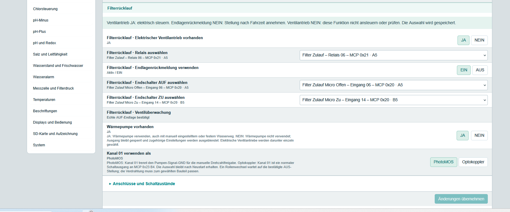

### Meine umgebaute Dosierpumpe

Als Basis dient ein SEKO PP Dosiergerät für die Spülmaschine Meiko FV28GIO. Ich habe es auf meinen Aufbau angepasst, das Gehäuse gedruckt und die Pumpe mit 24 V aufgebaut. Verwendet werden ein SEKO-Drehkreuz und ein Santoprene-Schlauch mit 6,25 × 10,65 mm.

Die Fördermenge habe ich ausgelitert, damit die Dosierung zur tatsächlichen Pumpe passt. Eine Freilaufdiode am Gleichstrommotor begrenzt die Spannungsspitze beim Abschalten. Ein Foto der fertigen Pumpe folgt noch.

## Bedienung und Messverläufe

Am Gerät lassen sich die Werte auf zwei Displays ablesen und die Menüs mit dem Drehknopf bedienen. Im Webportal sind Einstellungen, Messwerte und Diagnose nach Anlagenbereichen sortiert. Dort kann ich auch kalibrieren, Störungen ansehen und die Konfiguration sichern.

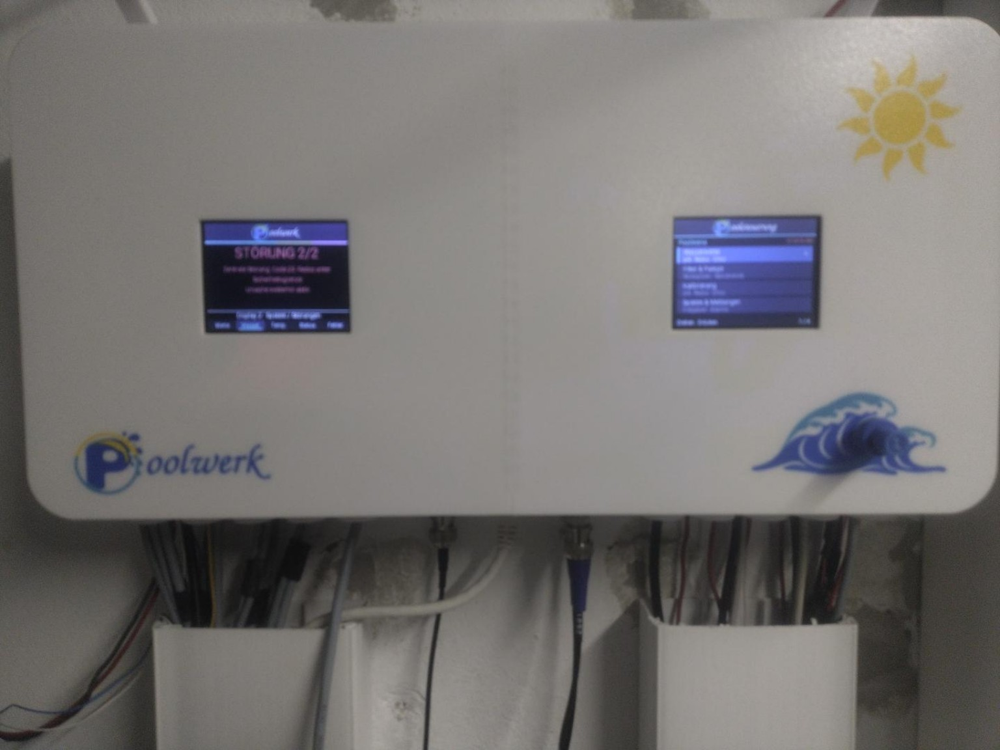

Bedienmenü und Störungsanzeige ansehen

| Bedienung mit Drehknopf | Beispiel einer Störungsmeldung |
| --- | --- |
|  | 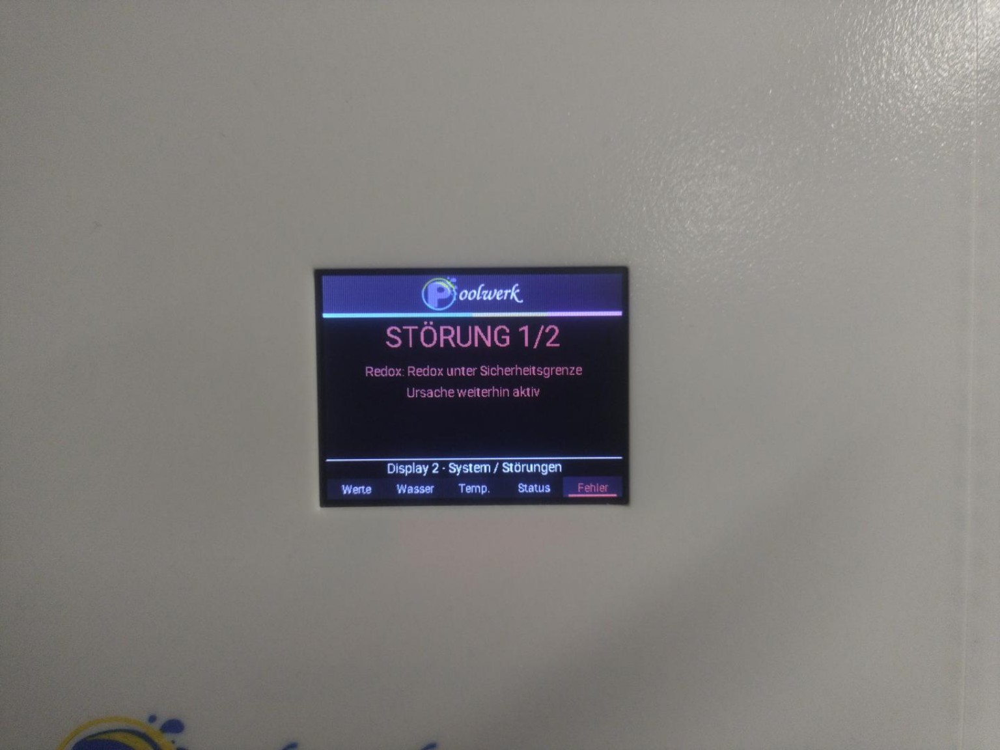 |

Filterpumpe, Wärmepumpe sowie pH und Redox ansehen

**Filterpumpe:** Zuordnung der Pumpenstufen und Ventile; weitere Reiter führen zu Betrieb, Wochenprogramm, Messwerten und Diagnose.

**Wärmepumpe:** Betriebsart, Schaltausgang, MQTT-Anbindung und zugehörige Ventile lassen sich passend zur Ausstattung einstellen.

**pH und Redox:** Sollwerte, Anzeigebereiche und Regelgrenzen sind getrennt einstellbar. Kalibrierung und Messwerte haben eigene Reiter.

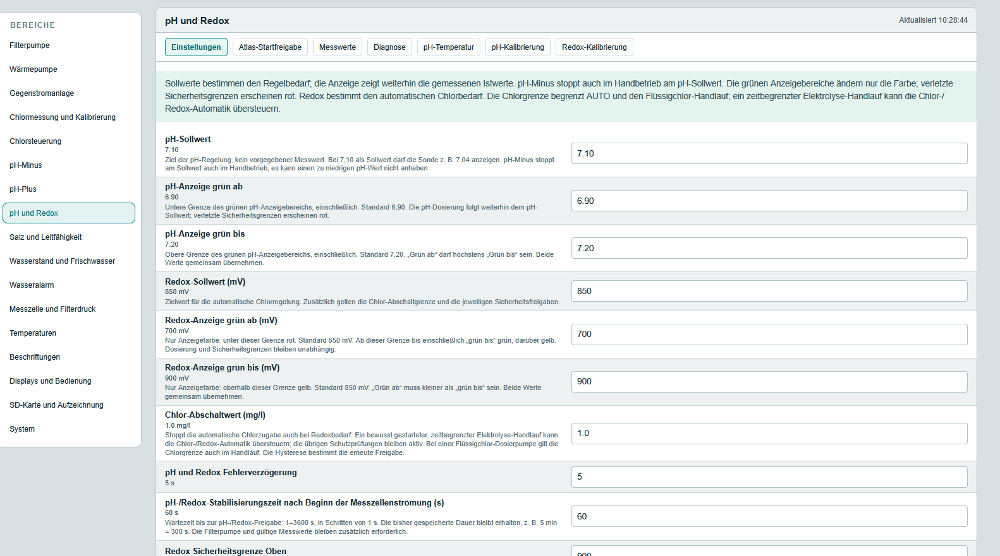

Systemdiagnose ansehen

Die Systemansicht zeigt CPU-Auslastung, Temperatur, freien Speicher und Laufzeit. Zähler zu LAN-Unterbrechungen und Wiederherstellungen unterstützen die Fehlersuche.

Der Live-Mitschreiber hilft mir bei der Fehlersuche. Er zeigt die Messpunkte und ihre Schwankungen, sodass sich zum Beispiel Veränderungen beim Pumpenstart nachvollziehen lassen.

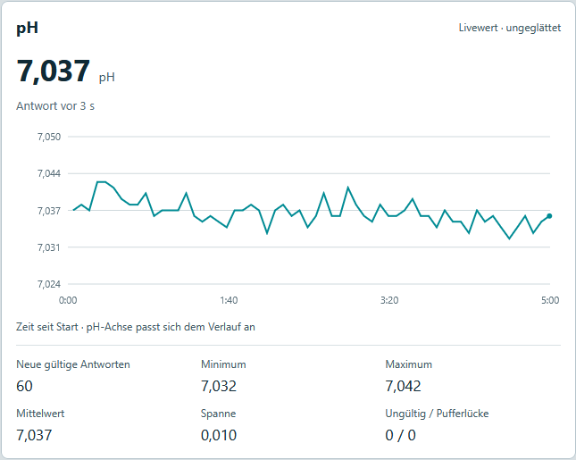

Home Assistant nutze ich zusätzlich als Übersicht im Haus. Die eigentliche Poolsteuerung bleibt im Poolwerk-Gerät.

Mein Home-Assistant-Dashboard

## Chemie-Rechner

Im Webportal steckt auch ein manueller Rechner für aktives Chlor, Chlorzugabe, pH-Minus, pH-Plus und Alkalinität. Dafür trägt man seine Messwerte, das Beckenvolumen und die Angaben des jeweiligen Produkts ein.

Beim aktiven Chlor wird aus DPD1, Cyanursäure und pH ein Modellwert bei 25 °C berechnet. Das ist keine zusätzliche Sensormessung. Der Rechner verändert keine Sollwerte und startet keine Dosierung.

Ansicht der Chlor-Mengenberechnung öffnen

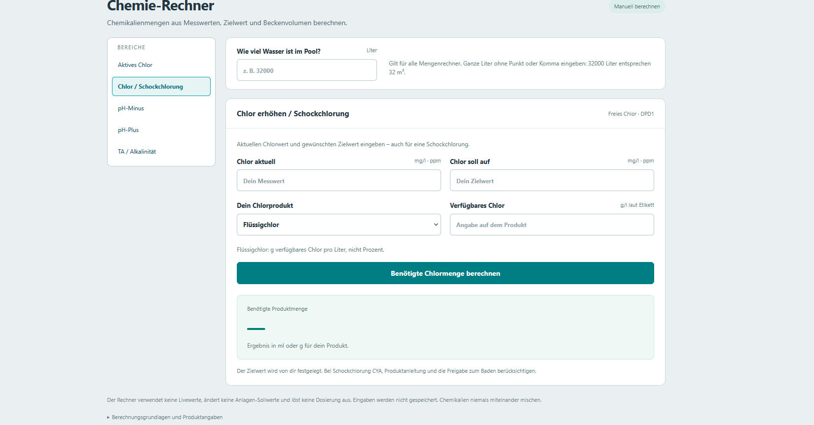

## Konstruktionen aus Fusion

Die Belimo-Halterungen, Adapter und Betätigungsteile für die Endschalter habe ich in Fusion gezeichnet und an meine Ventile angepasst. Dazu gehören auch ein längerer Mikroschalter-Pin, Stopfen für die Messsonden und die Gestaltung des Gehäuses.

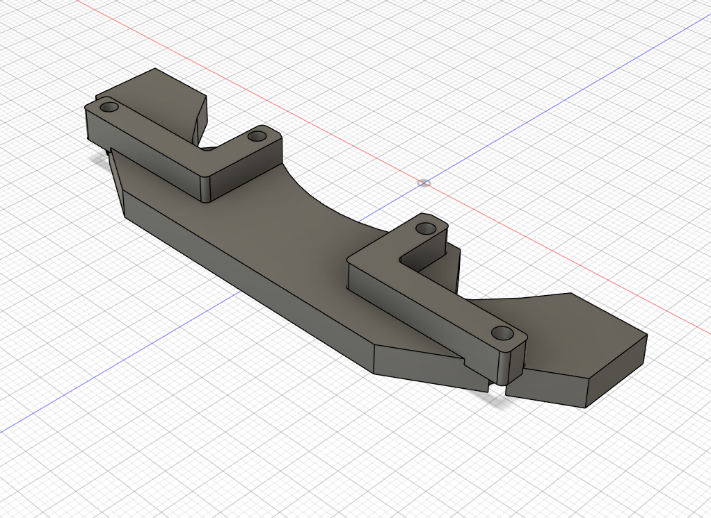

Weitere Fusion-Ansichten: Platte, Adapter und Mikroschalter-Pin

| Platte mit Befestigungsbohrungen | Geripptes Adapterteil |
| --- | --- |
| 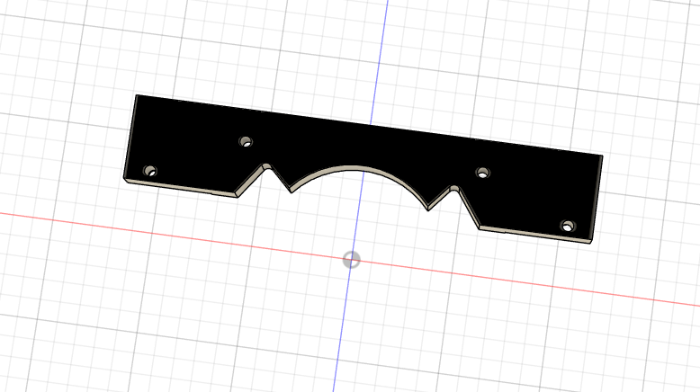 |  |

| Weiteres Verbindungsteil | Längerer Betätigungspin für den Mikroschalter |
| --- | --- |
|  | 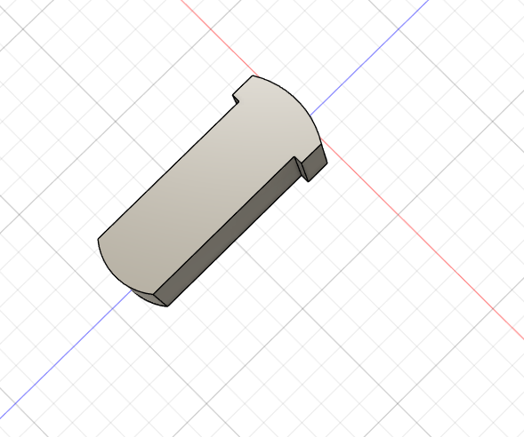 |

Sondenstopfen, Gehäuse und Front in Fusion

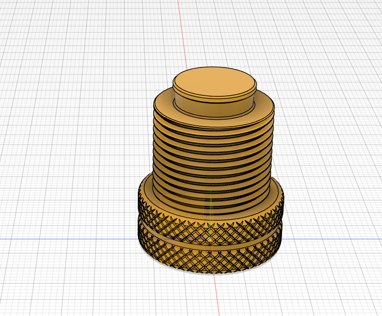

Die Grundzeichnung zeigt die Anordnung der Elektronik. Zusätzliche Halterungen und Erweiterungen werden ins Gehäuse eingeklebt.

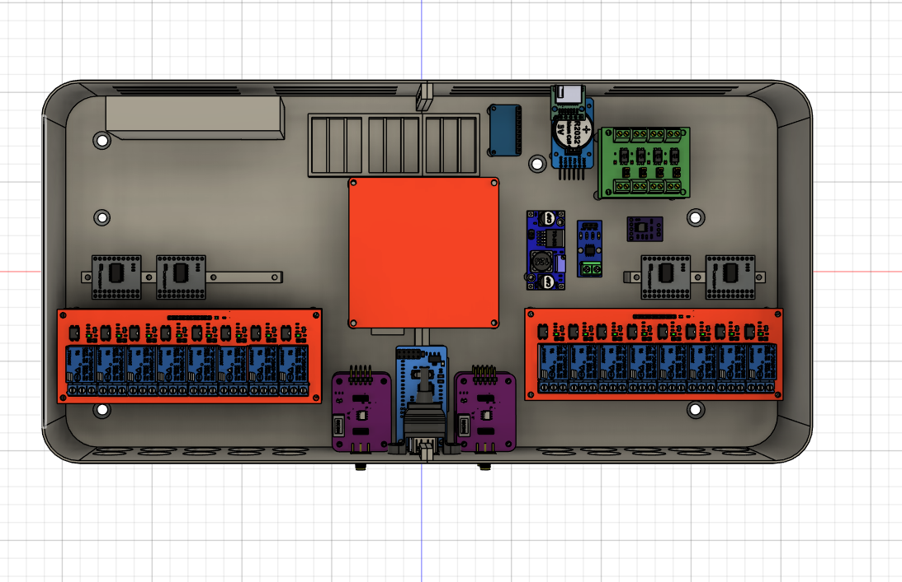

## Vom Prototyp zur eigenen Platine

Die Verkabelung im Prototyp ist noch etwas wild. Da wurde ergänzt, umgebaut und ausprobiert – genau das zeigen die Fotos auch.

Einbau der Steuerung im Technikraum

Für Poolwerk V2.0 ist eine eigene Trägerplatine in Vorbereitung. Sie passt ins Gehäuse und soll die Module, Anschlüsse und Versorgung übersichtlicher zusammenbringen. Damit wird auch der Aufbau mit deutlich weniger Einzelverdrahtung möglich.

Die Fusion-Ansicht zeigt den geplanten Aufbau. Die Platine ist der nächste Schritt in der Weiterentwicklung.

## Wie es weitergeht

Poolwerk läuft an meinem eigenen Pool. Neue Funktionen und Verbesserungen entstehen aus dem, was mir dort im Betrieb auffällt. Später möchte ich die Steuerung in einem kleinen Kreis auch an weiteren Pools einsetzen und Erfahrungen mit anderen Anlagen sammeln.

Hier gibt es Bilder, Einblicke in den Aufbau und eine kleine Leseprobe. Firmware und vollständige CAD-Dateien stelle ich in diesem Repository derzeit nicht bereit. Die Fotos und Screenshots zeigen verschiedene Entwicklungsstände.

[PDF-Leseprobe: die ersten zwei Seiten der Anleitung 096-351](dokumentation/Poolwerk_096-351_Anleitung_Leseprobe_Seiten_1-2.pdf)

Die Leseprobe enthält Titelseite und Inhaltsverzeichnis. Die zur installierten Firmware passende vollständige Anleitung lässt sich direkt an der Steuerung unter **Einstellungen → System → Anleitung herunterladen (PDF)** öffnen.
