# Poolwerk – die Steuerung

Poolwerk ist die Steuerung, die ich für meine eigene Poolanlage gebaut habe. Filterung, Wasserpflege und Wasserwege lassen sich damit von einer Stelle aus bedienen und überwachen. Vorher lief meine Anlage mit einer ProCon.IP; beim Aufbau meines Webportals sind einige Ähnlichkeiten wiederzuerkennen.

**Poolwerk deckt weit mehr als eine reine Dosier- oder Filtersteuerung ab.** Wasserpflege, Pumpen, Ventile, Wärmepumpe, Gegenstromanlage, Überwachung, Diagnose und Home Assistant sind in einer gemeinsamen Steuerung zusammengeführt. Dabei lässt sich der Funktionsumfang an die jeweilige Anlage anpassen.

## Eigenständiger Betrieb und Rolle von ESPHome

**Poolwerk läuft allein. Auch wenn Home Assistant ausgeschaltet ist, neu startet oder vollständig ausfällt, arbeitet die lokale Poolsteuerung auf dem ESP32-S3 weiter. Home Assistant ist keine Voraussetzung für den Anlagenbetrieb.**

Messwerterfassung, Regelung, Zeitprogramme, Ventilabläufe und die vorgesehenen Überwachungsfunktionen werden direkt auf dem ESP32 ausgeführt. Dafür benötigt Poolwerk weder einen laufenden Home-Assistant-Server noch eine Cloud oder Internetverbindung. Voraussetzung bleiben die Stromversorgung der Steuerung und die für die jeweilige Funktion angeschlossene Anlagentechnik.

### Direkte Verarbeitung auf der Steuerung

**Poolwerk ist auf schnelle, direkte Reaktionen ausgelegt:** Lokale Messwerte und Eingaben werden auf dem ESP32 verarbeitet, ohne den Umweg über Home Assistant oder einen Cloud-Dienst. Ein lokaler Schaltablauf muss deshalb nicht erst eine Antwort eines externen Servers abwarten. Eingestellte Wartezeiten, Messintervalle, Dosierpausen und Ventilfahrzeiten bleiben dabei bewusst wirksam; eine pauschale Reaktionszeit für alle Funktionen wird nicht zugesagt.

### Was bei einem Ausfall von Home Assistant passiert

| Funktion | Verhalten ohne Home Assistant |
| --- | --- |
| Lokale Anlagenlogik | Läuft auf dem ESP32 weiter |
| Lokal eingerichtete Regelungen, Zeitprogramme und Überwachungen | Werden weiterhin auf der Steuerung ausgeführt |
| Displays und Drehencoder | Bleiben direkt am Gerät bedienbar |
| Eigenes Webportal | Bleibt über das lokale Netzwerk erreichbar, sofern die Netzwerkverbindung zur Steuerung besteht |
| Home-Assistant-Dashboard und dort eingerichtete Automationen | Stehen während des HA-Ausfalls nicht zur Verfügung |
| Externe Zusatzsignale, etwa PV-Freigaben oder MQTT-Befehle | Benötigen weiterhin ihre jeweilige Quelle und Verbindung; sie sind von der lokalen Anlagenlogik zu unterscheiden |

### ESPHome als technische Grundlage

**ESPHome mit ESP-IDF bildet die technische Grundlage der Firmware.** Darauf baut die für Poolwerk entwickelte Anlagenlogik mit eigenen Abläufen, Freigaben, Diagnosen und Bedienoberflächen auf. Die Bezeichnung „ESPHome“ bedeutet nicht, dass Home Assistant die Poolsteuerung ausführt.

Home Assistant dient als **optionale zusätzliche Anzeige und Bedienmöglichkeit**. Die Steuerung selbst sitzt im Poolwerk-Gerät.

## Poolwerk auf einen Blick

| Bereich | Funktionen |
| --- | --- |
| Wasserpflege | pH, Redox, freies Chlor und Salz; wahlweise Elektrolyse oder Flüssigchlor sowie einzeln aktivierbare pH-Minus-/pH-Plus-Funktionen |
| Filterung und Wasserwege | Wochenprogramm, Pumpenstufen, Durchfluss und Filterdruck; optionale motorisierte Ventile mit Endlagenrückmeldung |
| Frischwasser | Automatische Nachfüllung – an meiner Anlage bereits in Betrieb |
| Wasseralarm | Wassererkennung, Anforderung zum Schließen der vorgesehenen Ventile und sensorgesteuertes Ein-/Ausschalten der zusätzlichen Pumpe |
| Weitere Technik | Wärmepumpe, PV-Freigabe und Gegenstromanlage |
| Bedienung | Lokal über eigenes Webportal und zwei Displays mit Drehencoder; Home Assistant optional |
| Auswertung und Hilfen | Live-Mitschreiber, Diagnose, Konfigurationssicherung, Chemie-Rechner und PDF-Anleitung |
| Eigene Konstruktionen | Belimo-Halterungen, Adapter, Mikroschalter-Pins, Sondenstopfen und Gehäusegestaltung in Fusion |

Die Ausstattung lässt sich an die jeweilige Anlage anpassen. Auch ein Betrieb ohne motorisierte Ventile ist möglich.

## Inhaltsverzeichnis

- [Eigenständiger Betrieb und Rolle von ESPHome](#eigenständiger-betrieb-und-rolle-von-esphome)
- [Warum Poolwerk entstanden ist](#warum-poolwerk-entstanden-ist)
- [Für unterschiedliche Poolanlagen](#für-unterschiedliche-poolanlagen)
- [Was Poolwerk übernimmt](#was-poolwerk-übernimmt)
- [Abläufe und Überwachung](#abläufe-und-überwachung)
- [Hardware und technische Ausstattung](#hardware-und-technische-ausstattung)
- [Webportal](#webportal)
- [Chemie-Rechner](#chemie-rechner)
- [Home Assistant](#home-assistant)
- [Bedienung direkt am Gerät](#bedienung-direkt-am-gerät)
- [Anlage im Technikraum](#anlage-im-technikraum)
- [Automatische Frischwassernachfüllung](#automatische-frischwassernachfüllung)
- [Wasseralarm und Pumpe im Keller](#wasseralarm-und-pumpe-im-keller)
- [Eigene Konstruktionen in Autodesk Fusion](#eigene-konstruktionen-in-autodesk-fusion)
- [Die Steuerung als Prototyp](#die-steuerung-als-prototyp)
- [Einstellungen und Diagnose](#einstellungen-und-diagnose)
- [Kalibrierung, Wartung und Fehlersuche](#kalibrierung-wartung-und-fehlersuche)
- [Aus der Praxis entwickelt](#aus-der-praxis-entwickelt)
- [Messverläufe](#messverläufe)
- [Entwicklungsstand](#entwicklungsstand)
- [Einblick in die Anleitung](#einblick-in-die-anleitung)

## Warum Poolwerk entstanden ist

**Poolwerk entstand einzig und allein deshalb, weil die ProCon.IP für meine Anlage zu wenige Analogregeln und Eingänge bot.** Für meine zusätzlichen Belimo-Antriebe und deren Endschalter benötigte ich mehr Anschluss- und Auswertungsmöglichkeiten.

Meine Pooltechnik steht im Keller. Die Sorge, dass bei einem Defekt Poolwasser austreten und den Keller überfluten könnte, erklärt meine besonderen Anforderungen: Ich wollte Wasseraustritt erkennen, die betreffenden Wasserwege schließen lassen und eine zusätzliche Pumpe zum Abpumpen einbinden.

Ein Fahrbefehl allein bestätigt keine Ventilstellung. Deshalb melden Endschalter in meinem Aufbau zurück, ob die offene oder geschlossene Endlage tatsächlich erreicht wurde. Diese Rückmeldungen waren von Anfang an ein wichtiger Bestandteil des Konzepts.

## Für unterschiedliche Poolanlagen

Poolwerk lässt sich an die vorhandene Pooltechnik anpassen: **Flüssigchlor-Dosierung oder Salzelektrolyse, pH-Minus und pH-Plus** können je nach Ausstattung genutzt werden. Die einzelnen Funktionen lassen sich unabhängig aktivieren oder deaktivieren.

Auch **ohne Belimo-Antriebe oder andere motorisierte Ventile** ist ein Betrieb möglich. Ventilansteuerung und Endlagenrückmeldung können passend zur Anlage eingerichtet oder abgeschaltet werden.

## Was Poolwerk übernimmt

- **Filterpumpe und Wasserwege:** Wochenplan mit Drehzahlstufen, Überwachung von Durchfluss und Filterdruck sowie Rückmeldung der Ventilstellungen.
- **Wasserpflege:** Messung von pH, Redox, freiem Chlor und Salz sowie die jeweils aktivierte Dosierung oder Elektrolyse.
- **Weitere Pooltechnik:** Automatische Frischwassernachfüllung sowie Einbindung von Wärmepumpe, PV-Freigabe, Gegenstromanlage und Wassermeldern.
- **Auswertung:** Messverläufe, Laufzeiten und Diagnose helfen dabei, den Betrieb und mögliche Störungen nachzuvollziehen.

## Abläufe und Überwachung

### Filterbetrieb und Wasserwege

Für die Filterpumpe lassen sich Wochenprogramme mit bis zu 16 Zeitfenstern pro Wochentag einstellen. Weitere Drehzahlstufen sind optional: Eine Anlage mit nur einer angeschlossenen Stufe benötigt keine vollständige Dreistufen-Ansteuerung.

Ein eingeschalteter Ausgang bedeutet noch nicht, dass tatsächlich Wasser fließt. Deshalb unterscheidet Poolwerk zwischen der Anforderung an die Pumpe und der Laufbestätigung durch den Hauptdurchfluss. Filterdruck und Messzellendurchfluss liefern zusätzliche Informationen zum Anlagenzustand.

Bei motorisierten Ventilen werden die angeforderte Stellung und die vorhandenen Endschalter ausgewertet. Ohne Endlagenrückmeldung kann die eingestellte Fahrzeit verwendet werden; sie ist dann eine zeitbasierte Annahme und keine gemessene Stellung. Ohne elektrische Antriebe bleiben die betreffenden Ventilfunktionen deaktiviert. Damit passt das Konzept sowohl zu manuell eingestellten Wasserwegen als auch zu einer stärker automatisierten Anlage.

Die Rückspülfunktion unterstützt den Ablauf, ersetzt in meinem Aufbau aber nicht das manuelle Umstellen des Filterkopfs. Nach dem Rückspülen wird der reguläre Filterbetrieb bewusst wieder gestartet.

### PhotoMOS: aktive Freigabe der externen Pumpensignale

In meinem Aufbau schaltet ein **PhotoMOS den gemeinsamen Signal-GND der externen Drehzahlsteuerung der Filterpumpe**. Damit die betreffenden Steuersignale wirksam werden können, muss Poolwerk diese Verbindung aktiv freigeben. Der PhotoMOS schaltet dabei den Steuersignalweg, nicht die Netzversorgung der Pumpe.

**Die Freigabe benötigt eine aktive Ansteuerung.** In der hier verwendeten, im unbestromten Zustand offenen Ausführung wird die Verbindung erst durch Einschalten des PhotoMOS hergestellt. Fällt die Versorgung der Steuerung aus, entfällt auch diese Ansteuerung: Die Verbindung öffnet und die externe Drehzahlfreigabe über diesen Signalweg fällt weg. So bleibt dieser Freigabeweg bei einem Stromausfall der Steuerung nicht einfach geschlossen.

Das beschreibt gezielt das Verhalten dieser Schaltung. Wie die Pumpe bei fehlenden externen Signalen reagiert, hängt zusätzlich von ihrem Eingangskonzept und ihren Einstellungen ab; der PhotoMOS ist keine Trennung der Pumpen-Netzversorgung.

Im Webportal wird **Kanal 01 als „PhotoMOS“** eingerichtet. Alternativ kann derselbe Kanal als normaler Optokoppler-Schaltausgang verwendet werden. Die Auswahl muss zum tatsächlich verbauten Bauteil und zur Verdrahtung passen. Sie bleibt nach einem Neustart gespeichert; beim Wechsel der Rolle wartet die Steuerung auf die bestätigte AUS-Stellung.

PhotoMOS-Auswahl und Ventilrückmeldungen im Webportal ansehen

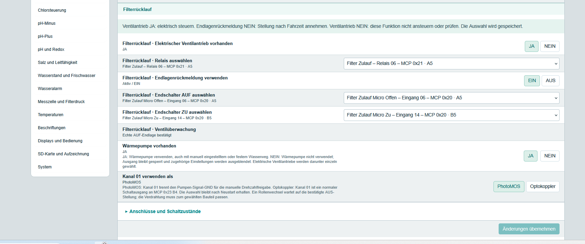

### Wasserpflege mit einstellbaren Grenzen

Bei der automatischen Chlorsteuerung bestimmt der Redoxbedarf die Anforderung. Die separate Chlormessung liefert zusätzlich den gemessenen Chlorwert und begrenzt die Chlorzugabe. Je nach gewähltem Verfahren wird eine Flüssigchlor-Dosierpumpe oder die Salzelektrolyse angesteuert.

Die pH-Minus-Regelung berücksichtigt die Abweichung vom Sollwert und die eingestellte Förderleistung. Dosierimpulse und Tagesmenge sind begrenzbar; auch bei einem Handlauf bleibt die pH-Sollwertfreigabe wirksam. pH-Plus ist als eigene, je nach Anlagenausstattung aktivierbare Funktion vorgesehen. Die einzelnen Verfahren müssen deshalb nicht alle gleichzeitig vorhanden sein.

Bei der Elektrolyse wird zusätzlich der Zellstrom überwacht. Zur Umpolung gehören Abschaltpause und Reststromprüfung. Ein zeitlich begrenzter, bewusst bestätigter Elektrolyse-Handlauf kann die automatische Redox-/Chlorentscheidung übersteuern. Bei Flüssigchlor bleibt die Chlorgrenze dagegen auch im Handlauf wirksam.

### Wärmepumpe und weitere Verbraucher

Die Wärmepumpe lässt sich mit Filterpumpenabhängigkeit, Startwartezeit und PV-Freigabe einbinden. Während des Rückspülens bleibt sie ausgeschaltet. Auch Gegenstromanlage, Wasserstand und Wasseralarme haben eigene Bereiche in der Oberfläche.

Der Umfang ergibt sich aus der tatsächlich angeschlossenen Technik: Poolwerk muss nicht mit allen Modulen ausgebaut werden, um an einer einfacheren Anlage sinnvoll eingesetzt zu werden.

## Hardware und technische Ausstattung

### ESP32-S3 als Zentrale

Im aktuellen Aufbau arbeitet ein **ESP32-S3-DevKitC-1-N32R16V**. Die Firmware basiert auf **ESPHome mit ESP-IDF** und unterstützt zwei Boardprofile:

| Boardprofil | Flash-Speicher | PSRAM |
| --- | ---: | ---: |
| ESP32-S3 N32R16V – aktueller Aufbau | 32 MB | 16 MB |
| ESP32-S3 N16R8 – ebenfalls unterstützt | 16 MB | 8 MB |

Der ESP32 übernimmt die Messwerterfassung, Steuerungsabläufe, Freigaben, Displays und das Webportal. Der zusätzliche Speicher wird unter anderem für die Oberfläche, Anzeigen und Laufzeitdaten genutzt. Die Auswahl des Boardprofils erfolgt in der Firmwarekonfiguration.

### Sonden und Messmodule

| Messung | Verwendete Technik | Aufgabe in Poolwerk |
| --- | --- | --- |
| pH | pH-Elektrode mit **Atlas Scientific EZO-pH** | Erfassung des pH-Werts als Grundlage für Anzeige und pH-Regelung |
| Redox | Redox-Elektrode mit **Atlas Scientific EZO-ORP** | Messung des Redoxpotenzials und Ermittlung des automatischen Chlorbedarfs |
| Leitfähigkeit / Salz | **Apera 2301-C**, Zellkonstante K = 1,0, mit **Atlas Scientific EZO-EC** | Messung der Leitfähigkeit; daraus berechnet Poolwerk die Salzanzeige |
| Freies Chlor | **ProCon.Cl-Sonde mit Potentiostat**, ausgewertet über einen separaten **ADS1115** | Erfassung des Chlorsignals und zusätzliche Begrenzung der Chlorzugabe |
| Temperaturen | **DS18B20** | Messung beispielsweise an Messzelle, Skimmer und weiteren Anlagenstellen |
| Hauptdurchfluss | **TUF-2000M** über **RS485 / Modbus** | Anzeige des Volumenstroms und Überwachung des Wasserflusses |
| Messzellendurchfluss | Impulsgeber **Y201** | Erfassung des Durchflusses durch die Messzelle |
| Filterdruck | Analoger Drucksensor am **ADS1115** | Überwachung des Filterdrucks |
| Elektrolysestrom | **ACS712**, im eigenen Aufbau die 20-A-Ausführung | Überwachung des Zellstroms; die Software unterstützt die Auswahl zwischen 20-A- und 30-A-Sensor |

Die Leitfähigkeitssonde besitzt keinen eigenen Temperaturfühler. Für die Temperaturkompensation verwendet Poolwerk die zugeordnete Messzellentemperatur. pH, Redox und Leitfähigkeit werden über die Atlas-Messmodule ausgelesen; Kalibrierung und Diagnose sind in die Bedienoberfläche integriert.

### Erweiterungen und Ein-/Ausgänge

Vier **MCP23017** erweitern den ESP32 um insgesamt **64 digitale Ein-/Ausgänge**. Im Aufbau sind davon **24 Relaiskanäle** und **16 Endschaltereingänge** vorgesehen. Weitere Anschlüsse dienen unter anderem dem Encoder-Taster, Wasserstandssensoren, Wasseralarmen, Optokopplern und zusätzlichen Steuereingängen; ein Teil bleibt als Reserve.

**Erweiterbar auf fünf MCP23017 und acht zusätzliche Relais:** Mit einem fünften MCP23017 lässt sich die digitale Ausstattung von 64 auf **80 Ein-/Ausgänge** erweitern. Zusätzlich sind **acht weitere Relaiskanäle** möglich, sodass der Ausbau insgesamt **32 Relaiskanäle** umfasst. Diese Angaben beschreiben die Erweiterungsmöglichkeit; der oben beschriebene Aufbau verwendet vier MCP23017 und 24 Relaiskanäle.

Zwei **ADS1115-Messmodule** erfassen die analogen Signale. Ein Modul verarbeitet unter anderem Filterdruck, Elektrolysestrom, Batteriespannung der Echtzeituhr und das Bypass-Signal. Das zweite ist der galvanisch getrennten Chlormessung zugeordnet. Die Anzahl der vorgesehenen Kanäle bedeutet dabei nicht, dass jede angeschlossene Anlage alle Funktionen benötigt.

### Rauscharme Versorgung und galvanische Trennung

Die **Atlas-Carrier werden über einen LT3045-Spannungsregler versorgt**. Dieser besonders rauscharme Linearregler ist für empfindliche Messschaltungen ausgelegt und unterdrückt Störungen aus der Versorgung. Das ergänzt die galvanische Trennung der Messkreise und soll Versorgungseinflüsse auf die Sondenauswertung möglichst gering halten. [Herstellerinformationen zum LT3045](https://www.analog.com/en/products/lt3045.html).

Die Messkreise für **pH, Redox, Leitfähigkeit und Chlor** sind galvanisch getrennt aufgebaut. Auch die Steuerungs- und Lastseite sind getrennt; ESP32 und Antriebe haben eigene Stromversorgungen.

Bei der Chlormessung kommen ein **isolierter TRACO-DC/DC-Wandler**, eine separate Platine mit **ADS1115** und eine **ISO1640-I²C-Trennung auf einem Pololu-5392-Modul** zum Einsatz. Mit diesem Aufbau konnte ich den zuvor beobachteten unerwünschten Abfall der Chloranzeige bei Anlagenstillstand beheben.

### Steuerung und Antriebe mit maximal 24 V

**Die Steuerungs- und Antriebsebene meiner Anlage arbeitet mit maximal 24 V.** Die Belimo-Ventilantriebe, die Dosieranlage und der Umschalter für die Umpolung der Elektrolyse arbeiten mit 24 V. Die Elektronik verwendet entsprechend ihrer Module auch niedrigere Versorgungsspannungen.

Verbraucher mit 230-V-Netzversorgung werden über **separate Schütze mit 24-V-Ansteuerung im Verteilerkasten** geschaltet. Poolwerk steuert dabei die 24-V-Spulen der Schütze an; deren Leistungskontakte schalten die Netzversorgung der jeweiligen Verbraucher. Die 24-V-Steuerung und die geschaltete Netzspannung sind damit klar voneinander zu unterscheiden.

### Antriebe, Bedienung und Kommunikation

- **Belimo-Antriebe mit Endschaltern** übernehmen in meiner Anlage die Ventile. Poolwerk wertet die Rückmeldungen aus und überwacht, ob die angeforderte Stellung erreicht wird.
- Für die Salzelektrolyse verwende ich eine **Zodiac LM2-40**. Die Steuerung übernimmt Freigabe, Stromüberwachung und automatische Umpolung. Alternativ ist Flüssigchlor-Dosierung vorgesehen.
- Zwei **TFT-Displays** und ein **EC11-Drehencoder mit Taster** ermöglichen die Bedienung am Gerät.
- Ein **W5500-Ethernetmodul** verbindet die Steuerung per LAN; zusätzlich steht WLAN zur Verfügung.
- Eine **DS3231-Echtzeituhr** und eine **microSD-Karte** ergänzen Zeitbasis und lokale Aufzeichnung. Die PDF-Anleitung liegt direkt im ESP-Flash.
- **ESPHome / Home Assistant**, MQTT und das eigene Webportal verbinden Messwerte, Bedienung und übergeordnete Hausautomation.

## Webportal

Die Übersicht zeigt Wasserwerte, Temperaturen und Betriebszustände. Darunter lassen sich die weiteren Anlagenteile bedienen und die Rückmeldungen der Wasserwege ansehen.

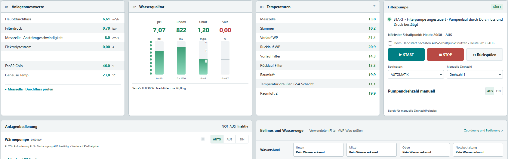

## Chemie-Rechner

Zum Webportal gehört ein **manuell bedienbarer Chemie-Rechner** mit Bereichen für aktives Chlor, Chlor / Schockchlorung, pH-Minus, pH-Plus sowie TA / Alkalinität. Er ergänzt die Anlagenbedienung um Berechnungen aus eingegebenen Messwerten, Zielwerten und Beckenvolumen.

### Aktives Chlor

Aus freiem Chlor (DPD1), Cyanursäure und pH-Wert berechnet der Rechner einen Modellwert für das aktiv wirksame Chlor (HOCl). Die Oberfläche kennzeichnet diesen ausdrücklich als **berechneten Wert bei 25 °C, nicht als Sensormessung**; die Angabe erfolgt als Cl₂-Äquivalent.

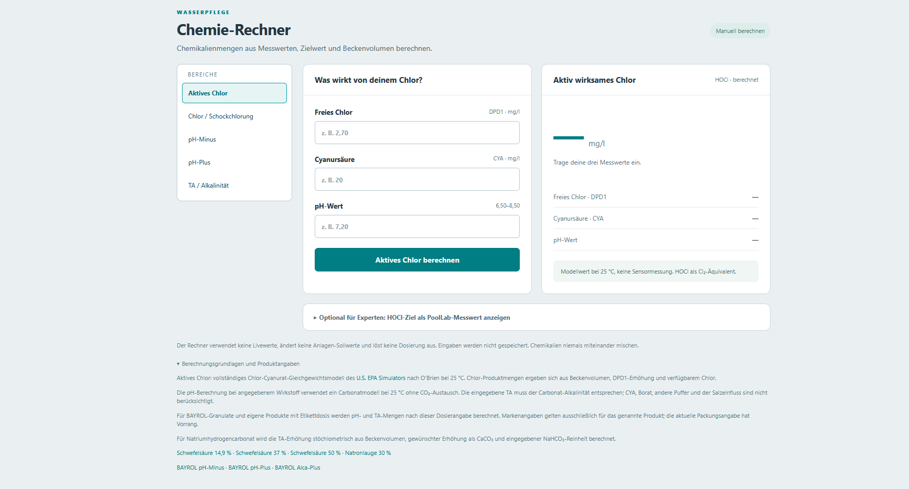

### Chlorzugabe und Schockchlorung

Für die Mengenberechnung werden Beckenvolumen, aktueller Chlorwert, selbst gewählter Zielwert und die Angaben zum verwendeten Chlorprodukt eingetragen. Bei Flüssigchlor wird das verfügbare Chlor in Gramm pro Liter laut Produktetikett angegeben. Das Ergebnis zeigt die berechnete Produktmenge.

Ansicht der Chlor-Mengenberechnung öffnen

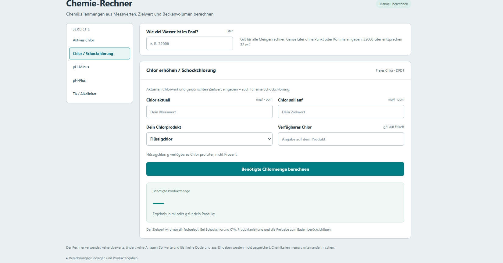

**Der Rechner verwendet keine Livewerte, verändert keine Anlagen-Sollwerte und löst keine Dosierung aus.** Die Eingaben werden nicht gespeichert. Die Berechnung ist eine separate Hilfe zur manuellen Wasserpflege; Produktangaben und Anwendungshinweise bleiben maßgeblich.

## Home Assistant

Poolwerk ist in meiner Anlage zusätzlich über **ESPHome in Home Assistant eingebunden**. Diese Anbindung ist optional; die Anlagenlogik läuft auf dem ESP32. Mein Dashboard zeigt Wasserqualität, Temperaturen, Betriebszustände, Durchfluss, Filterdruck und Störungsmeldungen. Über „Poolwerk öffnen“ erreiche ich das eigene Webportal.

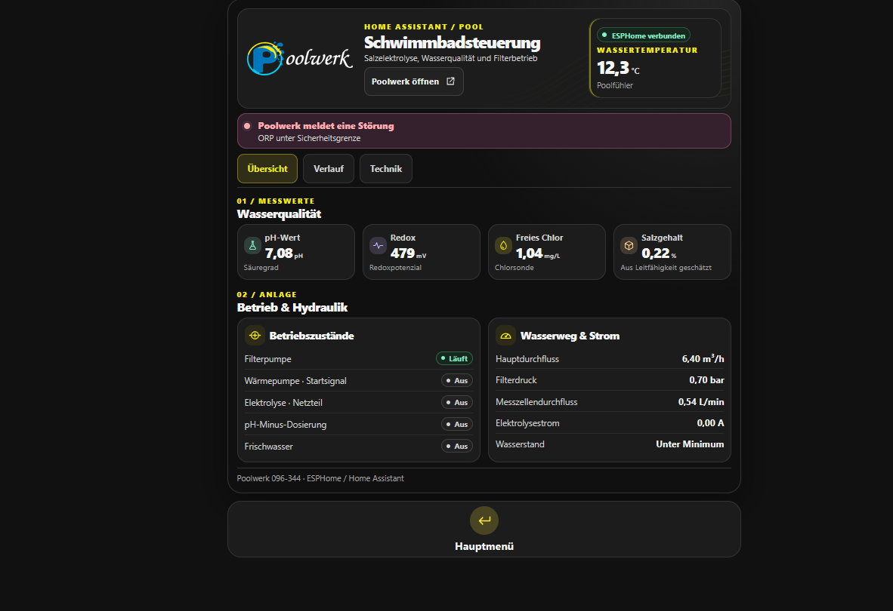

## Bedienung direkt am Gerät

Zwei Displays und ein Drehknopf ermöglichen die Bedienung vor Ort. Das Menü führt zu Wasserwerten, Filterpumpe, Kalibrierung und Systemmeldungen; Störungen werden mit ihrer Ursache angezeigt.

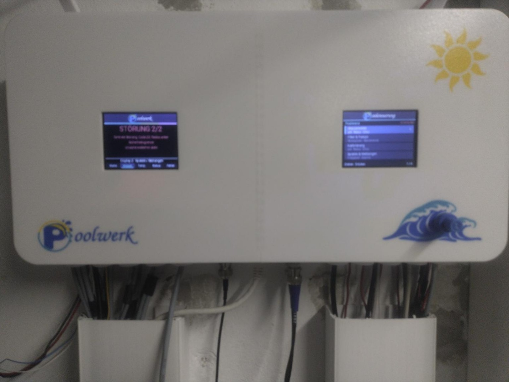

Bedienmenü und Störungsanzeige ansehen

| Bedienung mit Drehknopf | Beispiel einer Störungsmeldung |
| --- | --- |
| 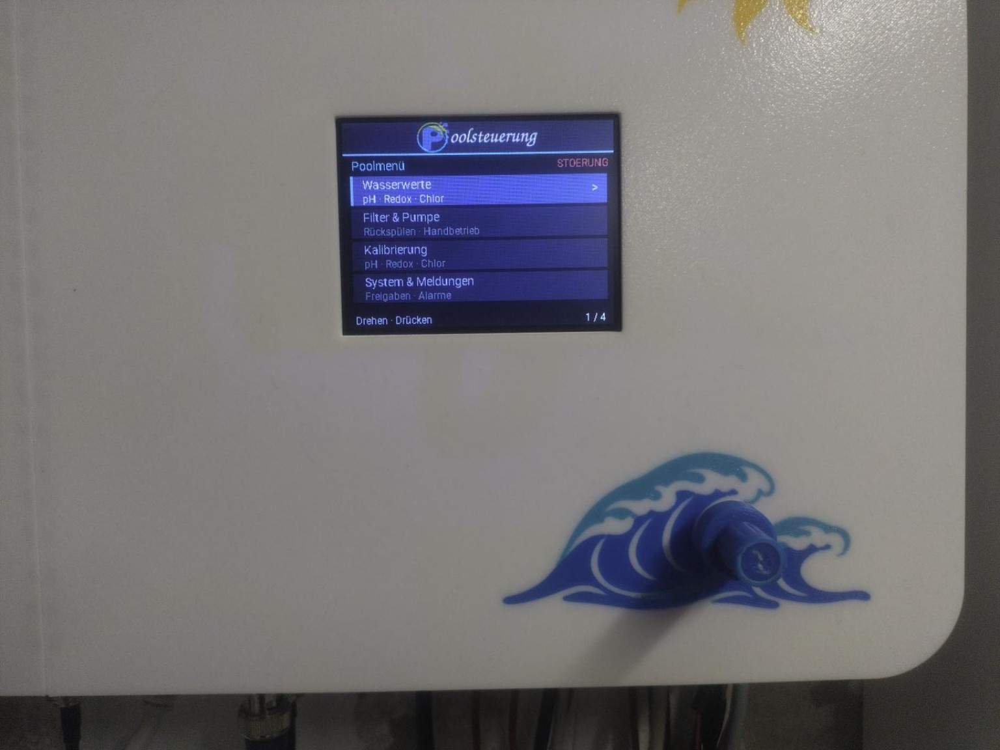 | 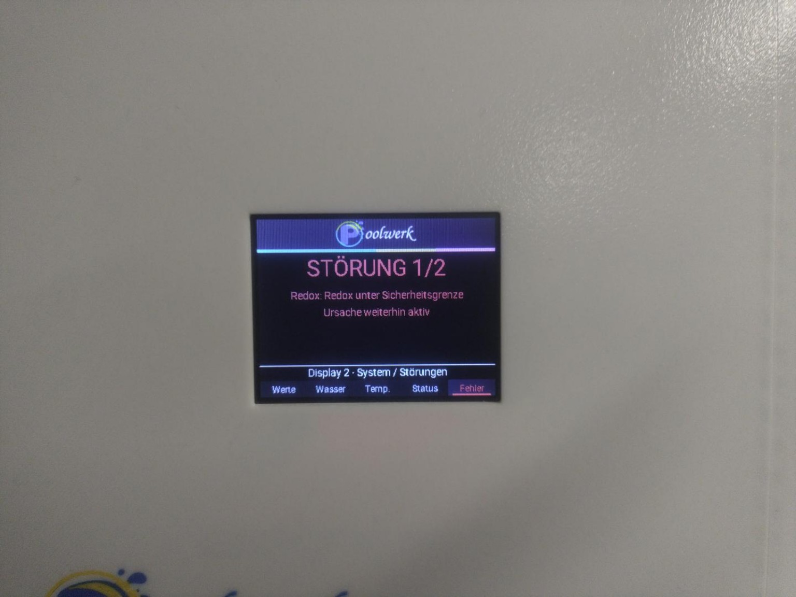 |

## Anlage im Technikraum

In meiner Anlage übernehmen Belimo-Antriebe die motorisierten Ventile. Angebaute Endschalter melden die Endlagen zurück, damit Poolwerk die erreichte Stellung erkennen kann.

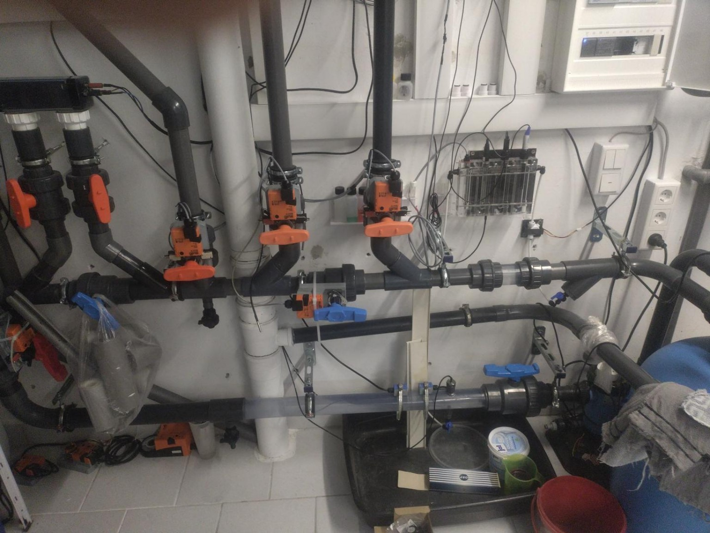

### Orientierung in der Anlage

Die Übersicht und die Detailfotos darunter zeigen die folgenden Baugruppen. Die Tabelle erklärt ihre Aufgaben; sie ist kein Rohrleitungs- oder Anschlussplan.

| Baugruppe | Auf den Fotos zu erkennen | Aufgabe |
| --- | --- | --- |
| Motorisierte Ventile | Orange Belimo-Antriebe an den Rohrleitungen, mit angebauten Mikroschaltern | Wasserwege umstellen und erreichte Endlagen zurückmelden |
| Messzelle | Transparente Messkammer mit angeschlossenen Sonden | Wasserwerte an einer gemeinsamen Messstelle erfassen |
| Elektrolyse | Elektrolyseeinheit in der separaten Detailaufnahme „Verrohrung und Elektrolyse“ | Chlorerzeugung bei freigegebenem Elektrolysebetrieb |
| Pumpe und Ventile | Eigene Detailaufnahme „Pumpe mit motorisierten Ventilen“ | Pumpenaufbau und zugehörige Absperrungen zeigen |
| Steuerungsgehäuse | Zwei Displays an der Front; offene Ansicht im Prototypenabschnitt | Messsignale auswerten, Abläufe steuern und Zustände anzeigen |
| Zusätzliche Pumpe im Keller | Eigenes Foto im Abschnitt „Wasseralarm und Pumpe im Keller“ | Erfasstes Wasser abführen; über die Wassererkennung ein- und ausschalten |

Weitere Fotos von Wasserwegen, Pumpe und Endschaltern

| Wasserweg im Technikraum | Ventilantrieb mit Endschaltern |
| --- | --- |
| 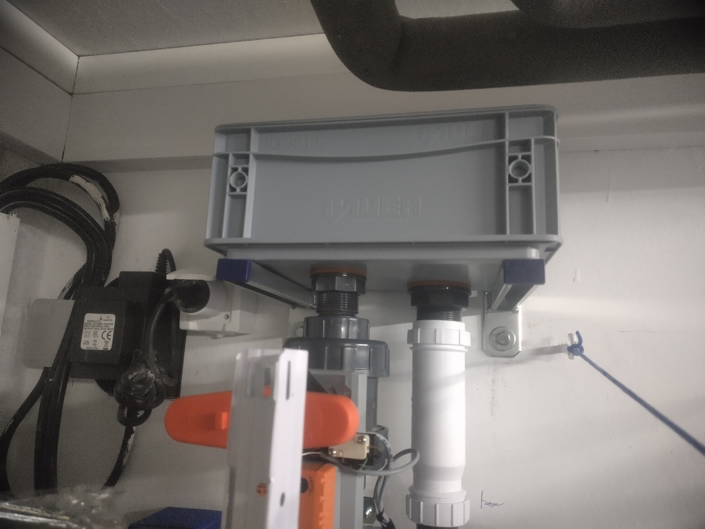 | 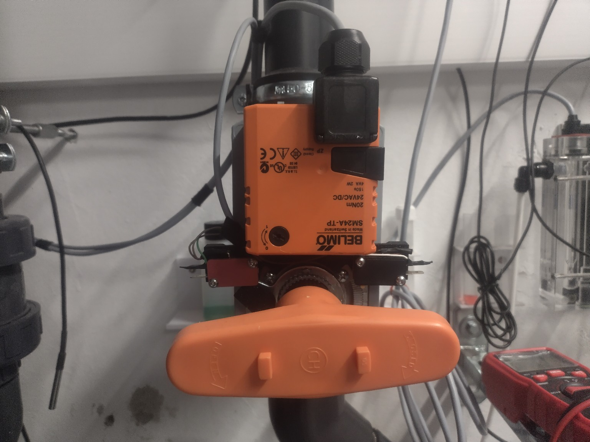 |

| Verrohrung und Elektrolyse | Pumpe mit motorisierten Ventilen |
| --- | --- |
| 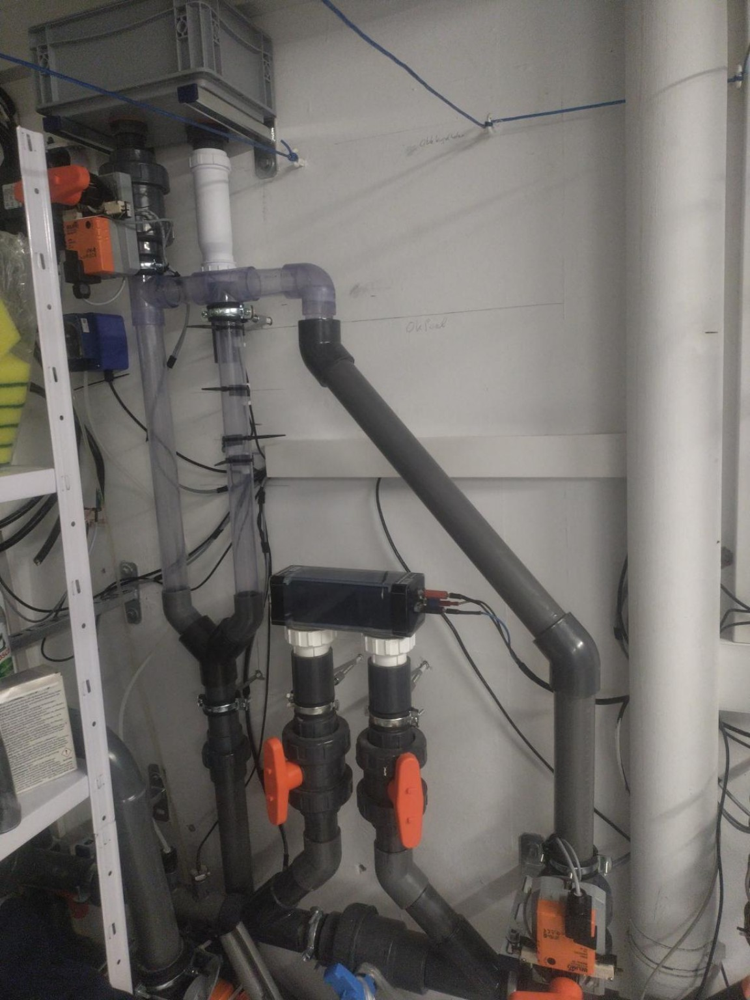 | 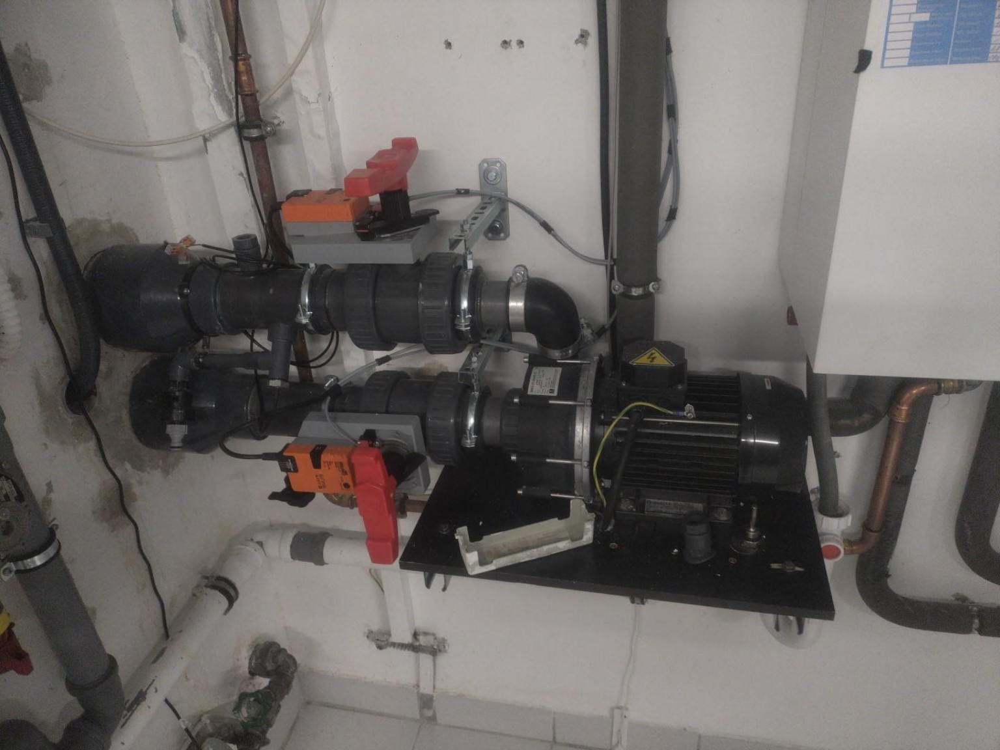 |

| Belimo mit rotem Ventilgriff | Endschalter im Detail |
| --- | --- |
| 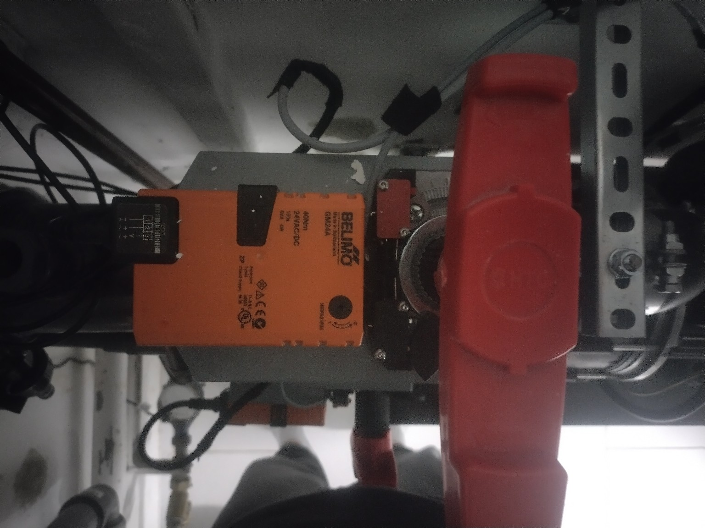 | 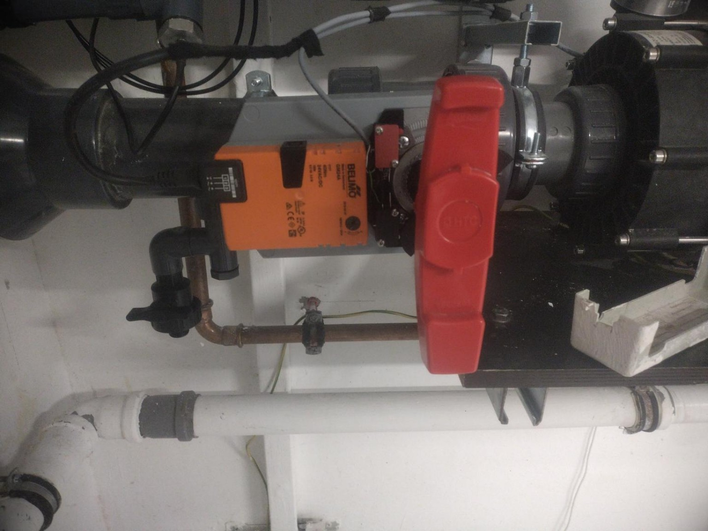 |

## Automatische Frischwassernachfüllung

**Die automatische Frischwassernachfüllung ist an meiner Anlage in Betrieb.** Sie ergänzt die Wasserstandsüberwachung und übernimmt das Nachfüllen von Frischwasser. Einrichtung, Messwerte und Diagnose sind im Webportal unter **„Wasserstand und Frischwasser“** zusammengefasst.

Damit gehört neben Wasserpflege und Filterbetrieb auch die Nachfüllung zur gemeinsamen Anlagensteuerung. Die Funktion wird passend zur vorhandenen Technik eingerichtet; eine Anlage ohne automatische Nachfüllung benötigt diesen Teil nicht.

## Wasseralarm und Pumpe im Keller

Ein Wassersensor erfasst austretendes Wasser. **Abhängig von seiner Meldung wird die zusätzliche Pumpe ein- und wieder ausgeschaltet.** Sie soll das erkannte Wasser aus dem Technikraum abführen.

Bei Wasseralarm fordert Poolwerk außerdem die dafür vorgesehenen motorisierten Ventile zum Schließen an. Über die Endschalter lässt sich prüfen, ob die angeforderten geschlossenen Endlagen erreicht wurden. Wassererkennung, Abpumpen und das Schließen der Wasserwege sollen gemeinsam einen möglichen Wasserschaden begrenzen.

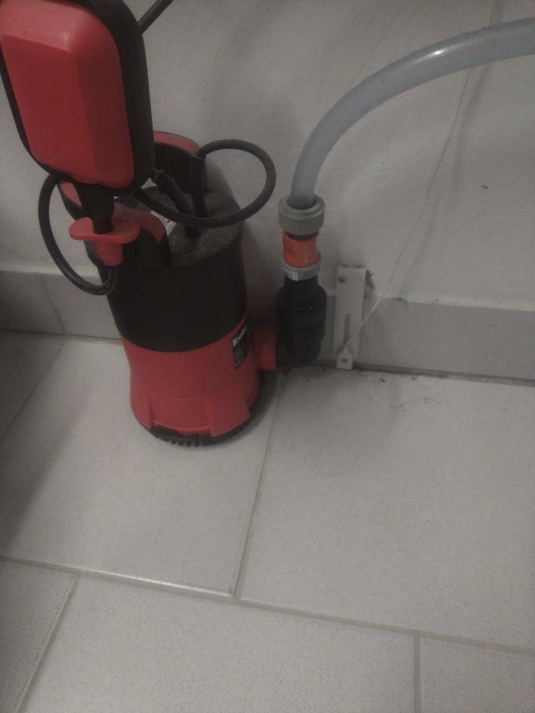

Die Aufnahme zeigt die zusätzliche Pumpe im Technikraum. Die Beschreibung bezieht sich auf meinen konkreten Anlagenaufbau.

## Eigene Konstruktionen in Autodesk Fusion

Zu Poolwerk gehört auch die mechanische Konstruktion. Die **Halterungen für die Belimo-Antriebe und die zugehörigen Adapterteile habe ich selbst in Autodesk Fusion gezeichnet** und an die vorhandenen Ventile angepasst. Die Bilder zeigen einzelne Konstruktionsteile; auf den Anlagenfotos ist der montierte Aufbau zu sehen.

Die Halterungen positionieren den Antrieb am Ventil. Ergänzende Adapter und Betätigungsteile stellen die mechanische Verbindung her. Für die Mikroschalter gibt es auch einen **längeren Betätigungspin**. Diese Schalter liefern die Endlagenrückmeldung, die Poolwerk anschließend in der Steuerung auswertet.

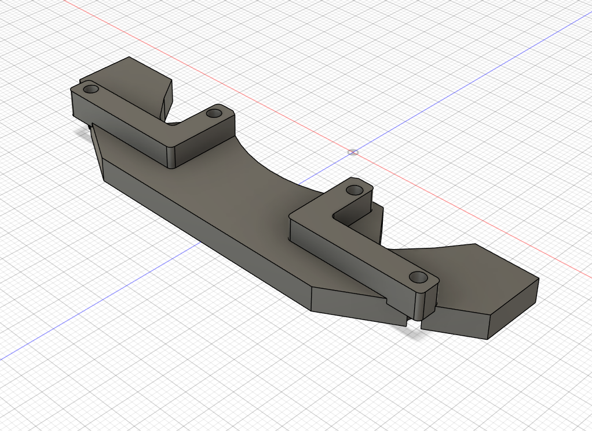

Weitere Fusion-Ansichten: Platte, Adapter und Mikroschalter-Pin

| Platte mit Befestigungsbohrungen | Geripptes Adapterteil |
| --- | --- |
| 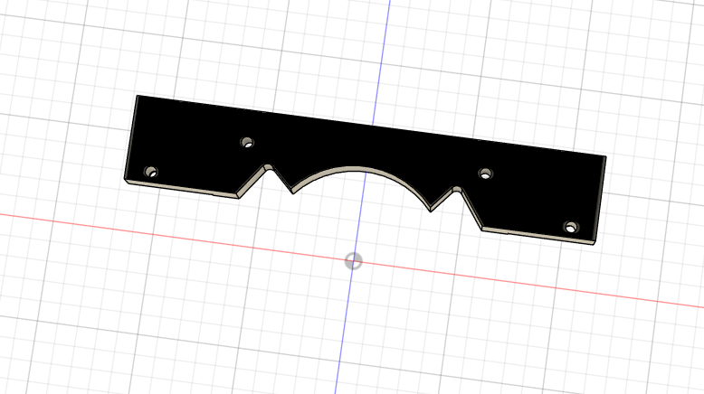 | 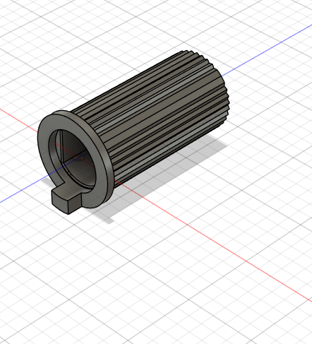 |

| Weiteres Verbindungsteil | Längerer Betätigungspin für den Mikroschalter |
| --- | --- |
| 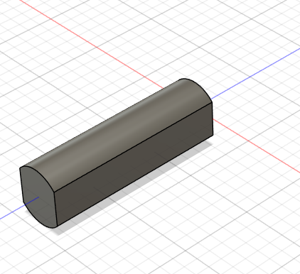 | 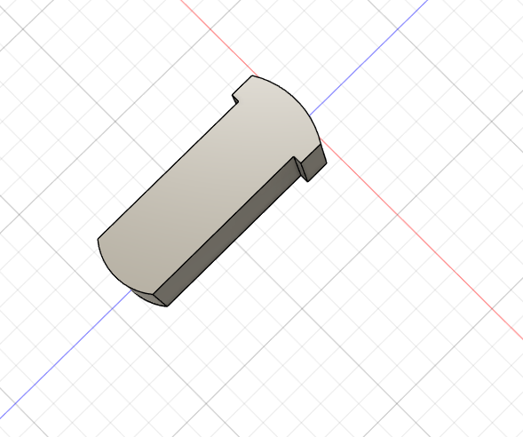 |

Die CAD-Ansichten dokumentieren die eigene Entwicklung ergänzend zu Elektronik und Software. Sie zeigen die Konstruktion, ohne die vollständigen CAD-Projektdateien zu veröffentlichen.

### Stopfen für die Messsonden

Auch ein eigener Stopfen für die Messsonden gehört zu den Fusion-Konstruktionen. Die Ansicht zeigt das Gewinde und den gerändelten Griffbereich.

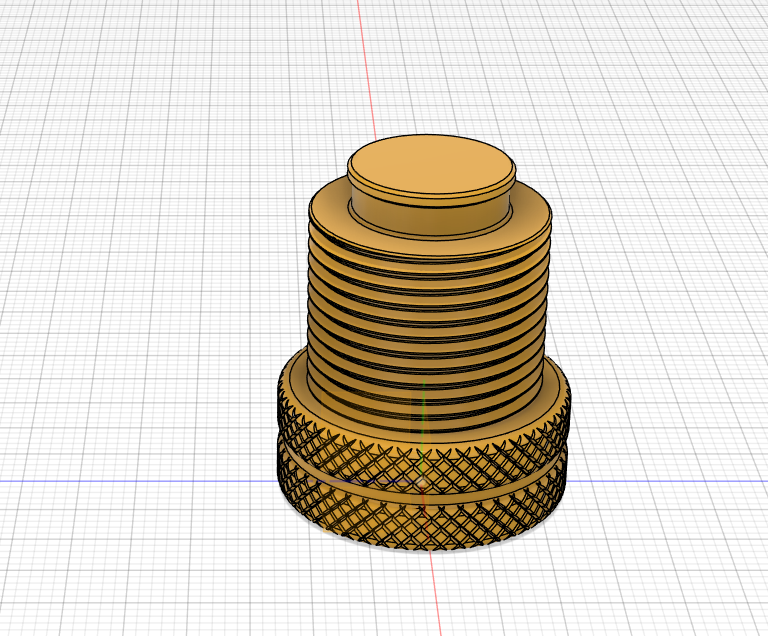

### Gehäuse und Anordnung der Elektronik

Auch für das Gehäuse gibt es eine eigene Grundzeichnung in Fusion. Sie zeigt die geplante Anordnung der Platinen, Relaismodule und weiteren Bauteile. Zusätzliche Halterungen und Erweiterungsteile werden nachträglich in das Gehäuse eingeklebt. Dadurch lässt sich der Aufbau während der Entwicklung ergänzen.

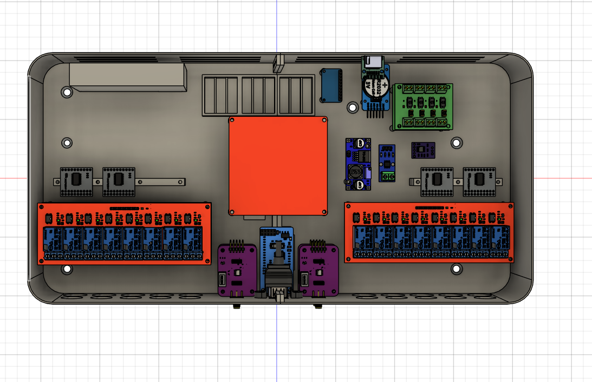

Die Zeichnung zeigt den konstruktiven Ausgangspunkt; die Fotos der offenen Steuerung dokumentieren den tatsächlich weiterentwickelten Prototyp.

### Gestaltung der Gehäusefront

Die Gehäusefront habe ich ebenfalls in Fusion gestaltet. Die Zeichnung zeigt die beiden Displayausschnitte, das Poolwerk-Logo sowie die Sonne und das Wellenmotiv mit der Öffnung für den Drehencoder. So gehört auch die Gestaltung der Bedienfront zur eigenen Konstruktion.

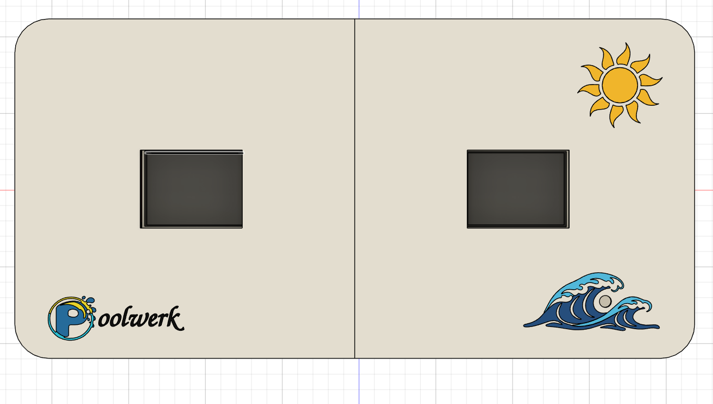

## Die Steuerung als Prototyp

Poolwerk ist ein **Prototyp im laufenden Aufbau**, der bereits an meinem Pool arbeitet. Die offene Ansicht zeigt den tatsächlichen Entwicklungsstand mit Steuerungsmodulen, Relais und Verdrahtung.

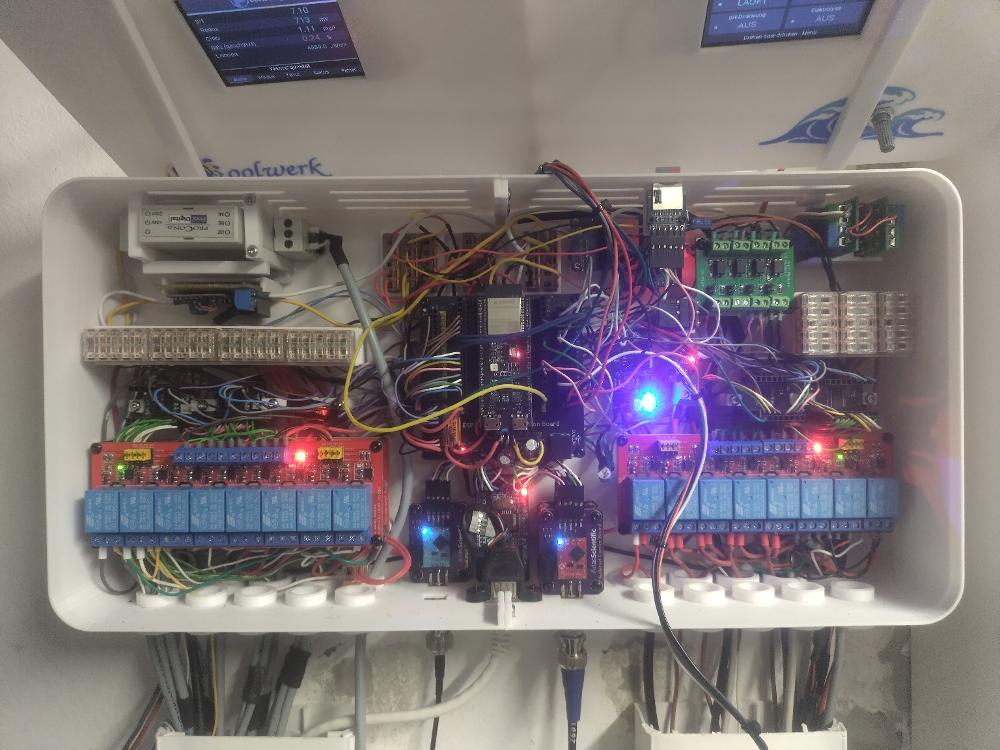

Einbau der Steuerung im Technikraum

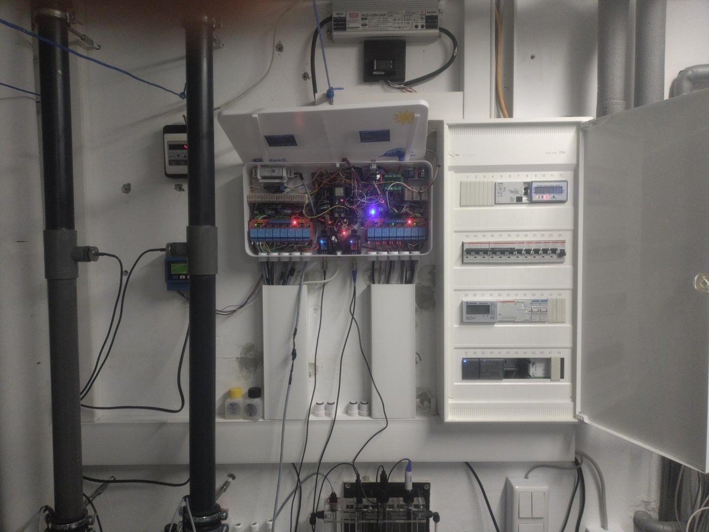

## Einstellungen und Diagnose

Die Einstellungen sind nach Anlagenbereichen gegliedert. Dort lassen sich unter anderem Betriebsarten, vorhandene Komponenten, Sollwerte und Grenzen anpassen. Die Screenshots zeigen die Einstellungen meiner Anlage. Eine Suche erleichtert das Auffinden einzelner Einstellungen. Über die Kopfleiste sind außerdem Störungsquittierung, Live-Mitschreiber, Chemie-Rechner und Poolübersicht erreichbar.

Filterpumpe, Wärmepumpe sowie pH und Redox ansehen

**Filterpumpe:** Zuordnung der Pumpenstufen und Ventile; weitere Reiter führen zu Betrieb, Wochenprogramm, Messwerten und Diagnose.

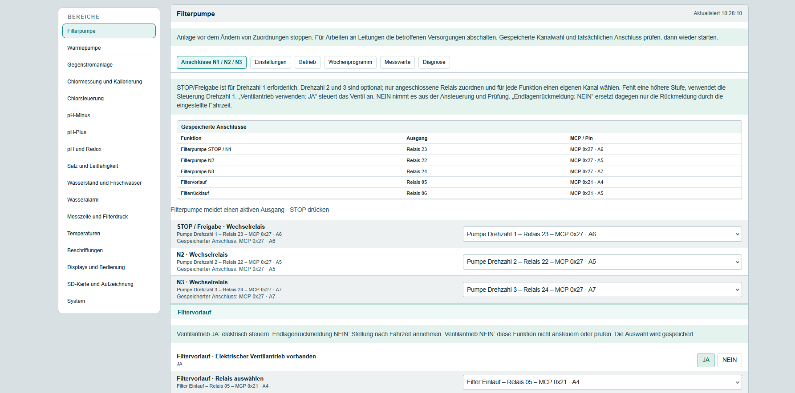

**Wärmepumpe:** Betriebsart, Schaltausgang, MQTT-Anbindung und zugehörige Ventile lassen sich passend zur Ausstattung einstellen.

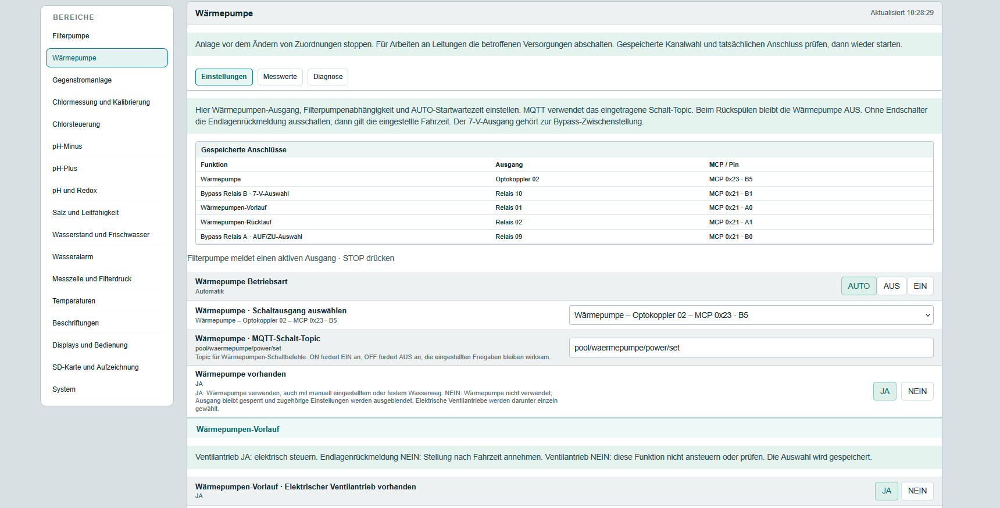

**pH und Redox:** Sollwerte, Anzeigebereiche und Regelgrenzen sind getrennt einstellbar. Kalibrierung und Messwerte haben eigene Reiter.

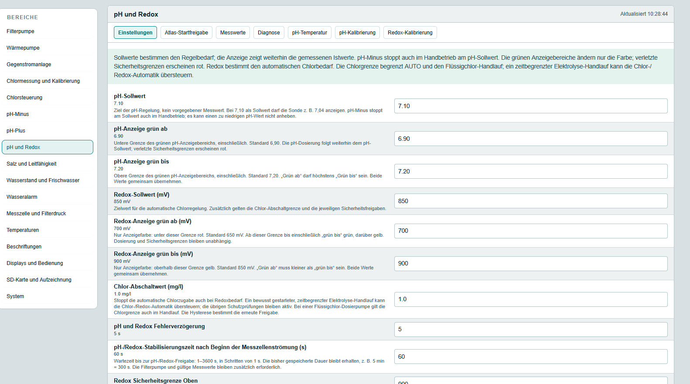

Systemdiagnose ansehen

Die Systemansicht zeigt CPU-Auslastung, Temperatur, freien Speicher und Laufzeit. Zähler zu LAN-Unterbrechungen und Wiederherstellungen unterstützen die Fehlersuche.

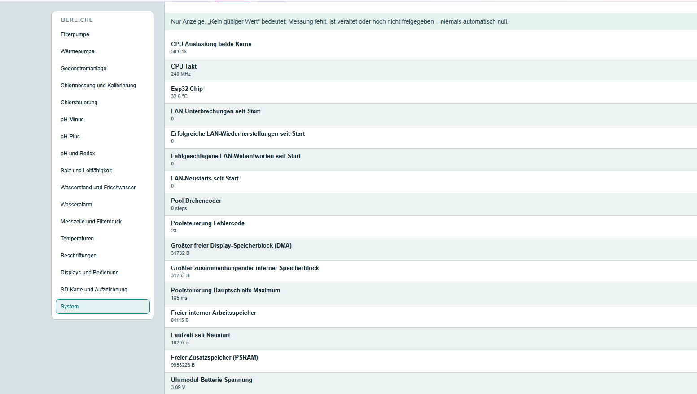

## Kalibrierung, Wartung und Fehlersuche

Zur Bedienung gehören eigene Kalibrierbereiche für pH, Redox, Chlor und Leitfähigkeit. Messwerte, Sollwerte und reine Anzeigebereiche werden getrennt behandelt: Eine Änderung der grünen Anzeigegrenzen verändert nicht automatisch die Dosierfreigaben.

Für die Fehlersuche lassen sich aktuelle Werte und Zustände im Portal ansehen sowie Diagnosedaten herunterladen. Der Mitschreiber ergänzt diese Momentaufnahme um einen zeitlichen Verlauf. So wird beispielsweise sichtbar, ob eine Veränderung mit einem Pumpenstart, einer Schaltung oder einer Messwertschwankung zusammenfällt.

Die Konfiguration kann als Datei gesichert und wiederhergestellt werden. Zusätzlich sind Sicherungen auf der SD-Karte vorgesehen. Kalibrierwerte in den Atlas-Modulen werden separat gespeichert; eine Konfigurationssicherung ersetzt daher nicht jede gerätespezifische Einstellung.

Die im Gerät hinterlegte PDF-Anleitung passt zur jeweiligen Firmware und lässt sich direkt aus dem ESP-Flash herunterladen. Dafür werden weder eine SD-Karte noch eine Internetverbindung benötigt, lediglich die Verbindung zur Steuerung.

## Aus der Praxis entwickelt

Poolwerk entsteht an meiner eigenen Anlage. Neben neuen Funktionen geht es dabei immer wieder um nachvollziehbare Messwerte, brauchbare Rückmeldungen und die Ursachen von Störungen.

Ein Beispiel war die Chlormessung: Bei Anlagenstillstand fiel der angezeigte Wert unerwünscht ab. Die getrennte Versorgung und die separate, galvanisch isolierte Messplatine waren Teil der Lösung. Auch die rauscharme Versorgung der Atlas-Carrier über den LT3045 gehört zu diesem Augenmerk auf die Messhardware.

Die Fotos zeigen deshalb bewusst auch die offene Steuerung. Sie dokumentieren einen arbeitenden Prototyp mit seinen tatsächlich verbauten Modulen und der gewachsenen Verdrahtung. Mechanik, Elektronik, Bedienoberfläche und Home-Assistant-Anbindung gehören für mich zu demselben Projekt.

## Messverläufe

Der Live-Mitschreiber zeigt ungeglättete Messpunkte und ihre Spanne. So lässt sich beispielsweise verfolgen, wie stark der pH-Wert über einige Minuten schwankt.

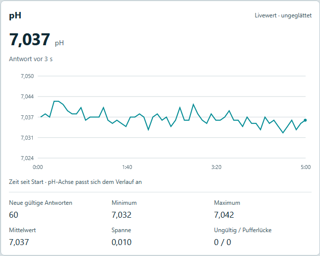

## Entwicklungsstand

**Stand: 9. November 2026.** Poolwerk arbeitet an meiner eigenen Poolanlage und wird im laufenden Projekt weiterentwickelt.

| Stand | Einordnung |
| --- | --- |
| Im Betrieb | Die Steuerung mit der angeschlossenen Mess- und Anlagentechnik, Bedienung am Gerät, Webportal und Home-Assistant-Anbindung |
| Frischwassernachfüllung | Installiert und in Betrieb; keine nur geplante Erweiterung mehr |
| Je nach Ausstattung nutzbar | Alternative Wasserpflegeverfahren und optionale Verbraucher – nicht jede unterstützte Funktion ist gleichzeitig an meiner Anlage verbaut |
| Laufende Weiterentwicklung | Feinabstimmung und Verbesserungen an Bedienung, Abläufen und mechanischem Aufbau auf Grundlage der Erfahrungen am eigenen Pool |
| Öffentliche Dokumentation | Fotos, Funktionsbeschreibungen, CAD-Ansichten und eine vierseitige Leseprobe der Anleitung; Screenshots zeigen jeweils den Stand ihrer Aufnahme |

## Einblick in die Anleitung

[**PDF-Leseprobe öffnen: erste vier Seiten der Anleitung 096-345**](dokumentation/Poolwerk_096-345_Anleitung_Leseprobe_Seiten_1-4.pdf)

Der Auszug enthält Titelseite, Inhaltsverzeichnis, aktuelle Anschlüsse und Installation. Das Inhaltsverzeichnis bezieht sich auf die vollständige Anleitung. Auf der Steuerung liegt die passende vollständige Ausgabe unter **Einstellungen → System → Anleitung herunterladen (PDF)**.

---

Dies ist ein Ausschnitt aus dem Projekt. Das Repository dient der Vorstellung; Firmware und vollständige Projektquellen werden hier nicht bereitgestellt.

