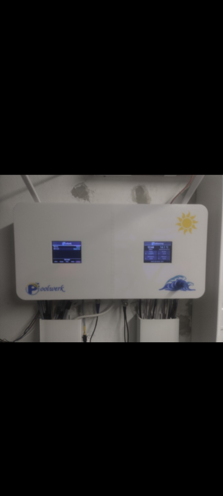

# Poolwerk

Poolwerk ist die Steuerung, die ich für meine eigene Poolanlage gebaut habe. Ich wollte Filterung, Wasserpflege und die Wasserwege von einer Stelle aus bedienen und sehen können, was gerade in der Anlage passiert. Vorher lief sie mit einer ProCon.IP. In meinem eigenen Webportal ist der Aufbau der Übersicht ähnlich.

## Webportal

In der Übersicht sehe ich die Wasserwerte, Temperaturen und den Zustand der Filterpumpe auf einen Blick. Die Anlage kann ich im Browser oder direkt am Gerät bedienen.

## Anlage im Technikraum

| Wasserweg im Technikraum | Ventilantrieb mit Endschaltern |
| --- | --- |
|  |  |

Gehäusefront mit zwei Displays

## Was Poolwerk im Alltag übernimmt

- **Filterpumpe und Wasserwege.** Die Pumpe läuft nach einem Wochenplan mit einstellbaren Drehzahlstufen. Druck und Durchfluss zeigen, ob sie tatsächlich läuft. Endschalter an den motorisierten Ventilen melden zurück, wann die gewünschte Stellung erreicht ist.
- **Wasserpflege.** Poolwerk erfasst pH, Redox, freies Chlor und Salz. Die Steuerung übernimmt auch die pH-Minus-Dosierung und die Salzelektrolyse.
- **Weitere Pooltechnik.** Wärmepumpe, Gegenstromanlage und Wassermelder im Technikraum sind eingebunden. Die Wärmepumpe kann eine Freigabe von der PV-Anlage bekommen.
- **Messverläufe und Diagnose.** Ich kann Messwerte und Laufzeiten nachsehen und bei Störungen erkennen, welche Rückmeldung oder Freigabe gerade fehlt.

## Ein Beispiel aus dem Betrieb

Im Live-Mitschreiber sehe ich, wie stark ein Messwert über einige Minuten schwankt. Hier ist ein Ausschnitt für den pH-Wert mit den einzelnen Messpunkten und der gemessenen Spanne.

Poolwerk läuft im Alltag an meinem eigenen Pool. Die automatische Frischwassernachfüllung ist als Erweiterung vorbereitet. Die Bilder zeigen einen Ausschnitt aus dem Projekt.
